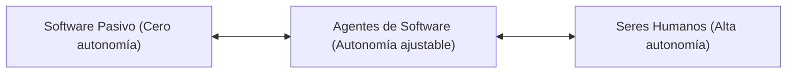
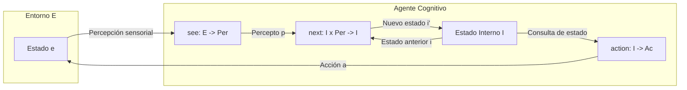
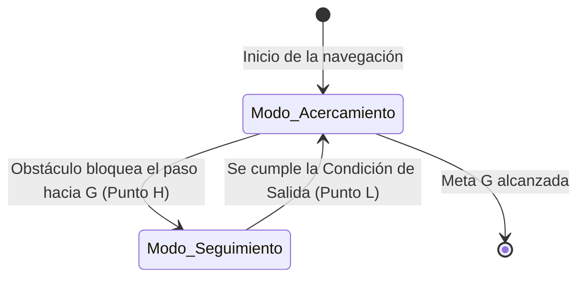
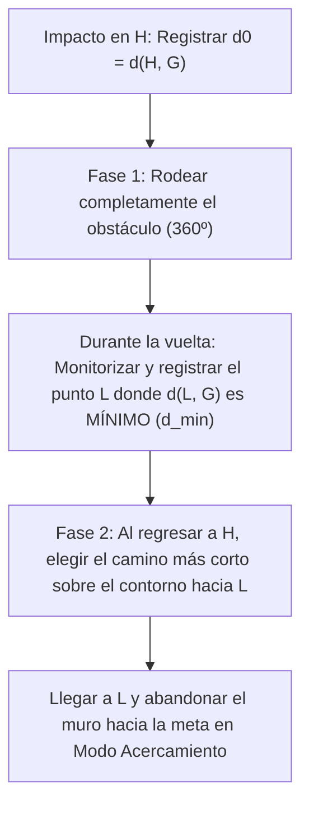
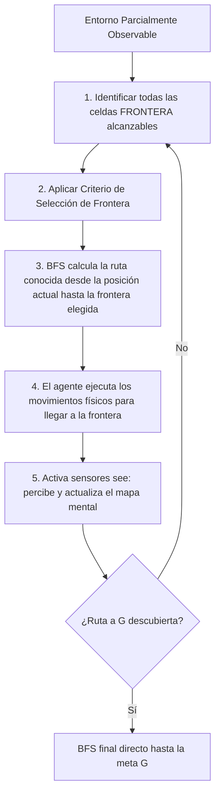
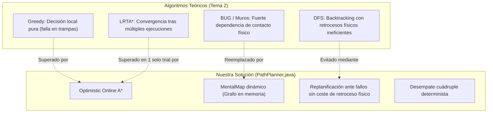

# Algoritmos del Tema 2: Autonomía y Navegación en Agentes

**Asignatura:** Diseño Basado en Agentes (DBA) — Curso 2026/2027  
**Profesor:** Manuel Jesús Cobo Martín — Universidad de Granada (UGR)  
**Material de Referencia:** Diapositivas de clase *Tema 2 - Autonomía* (103 transparencias)

---

## Índice General

1. [Marco Formal y Arquitectura Abstracta del Agente](#1-marco-formal-y-arquitectura-abstracta-del-agente)
   - [1.1 Definición de Agente y Grados de Autonomía](#11-definición-de-agente-y-grados-de-autonomía)
   - [1.2 Propiedades del Entorno y Modelo Formal](#12-propiedades-del-entorno-y-modelo-formal)
   - [1.3 Agentes Puramente Reactivos vs. Agentes con Estado Interno](#13-agentes-puramente-reactivos-vs-agentes-con-estado-interno)
   - [1.4 Funciones de Utilidad y Algoritmo Básico](#14-funciones-de-utilidad-y-algoritmo-básico)
2. [Algoritmo Greedy (Voraz / Elección Inmediata)](#2-algoritmo-greedy-voraz--elección-inmediata)
   - [2.1 Principio Operativo y Función Heurística](#21-principio-operativo-y-función-heurística)
   - [2.2 Métrica Euclídea vs. Métrica Manhattan](#22-métrica-euclídea-vs-métrica-manhattan)
   - [2.3 Regla Canónica de Desempate](#23-regla-canónica-de-desempate)
   - [2.4 Patología Crítica: Mínimos Locales y Oscilación](#24-patología-crítica-mínimos-locales-y-oscilación)
3. [Algoritmo con Memoria y Penalización de Visitas](#3-algoritmo-con-memoria-y-penalización-de-visitas)
   - [3.1 Función de Evaluación con Penalización](#31-función-de-evaluación-con-penalización)
   - [3.2 Modalidades: Penalización Fija vs. Lineal](#32-modalidades-penalización-fija-vs-lineal)
   - [3.3 Gestión de la Memoria: Historial Completo vs. Ventana Deslizante (Olvido)](#33-gestión-de-la-memoria-historial-completo-vs-ventana-deslizante-olvido)
   - [3.4 Ruptura del Bucle de Greedy y Límites de la Penalización](#34-ruptura-del-bucle-de-greedy-y-límites-de-la-penalización)
4. [Algoritmos de Seguimiento de Muros y Familia BUG](#4-algoritmos-de-seguimiento-de-muros-y-familia-bug)
   - [4.1 Arquitectura Bi-Modal (Acercamiento vs. Seguimiento de Contorno)](#41-arquitectura-bi-modal-acercamiento-vs-seguimiento-de-contorno)
   - [4.2 Giros Relativos y Regla de la Mano (Izquierda / Derecha)](#42-giros-relativos-y-regla-de-la-mano-izquierda--derecha)
   - [4.3 BUG0: Salida Inmediata vs. BUG0 con Criterio de Progreso](#43-bug0-salida-inmediata-vs-bug0-con-criterio-de-progreso)
   - [4.4 BUG1: Rodeo Exhaustivo del Contorno y Punto Óptimo $d_{min}$](#44-bug1-rodeo-exhaustivo-del-contorno-y-punto-óptimo-d_min)
   - [4.5 BUG2: Navegación por la Línea Directa ($m$-line)](#45-bug2-navegación-por-la-línea-directa-m-line)
   - [4.6 Matriz Comparativa de la Familia BUG](#46-matriz-comparativa-de-la-familia-bug)
5. [Búsqueda Sistemática en Espacios Discretos (DFS y BFS Online)](#5-búsqueda-sistemática-en-espacios-discretos-dfs-y-bfs-online)
   - [5.1 Búsqueda en Profundidad (DFS) y Retroceso Físico (Backtracking)](#51-búsqueda-en-profundidad-dfs-y-retroceso-físico-backtracking)
   - [5.2 Búsqueda en Anchura (BFS): Cálculo en Memoria vs. Movimiento Físico](#52-búsqueda-en-anchura-bfs-cálculo-en-memoria-vs-movimiento-físico)
   - [5.3 Exploración por Fronteras (Frontier Exploration)](#53-exploración-por-fronteras-frontier-exploration)
6. [Algoritmos Heurísticos en Tiempo Real: RTA\* y LRTA\*](#6-algoritmos-heurísticos-en-tiempo-real-rta-y-lrta)
   - [6.1 Fundamento: Toma de Decisiones Local con Aprendizaje](#61-fundamento-toma-de-decisiones-local-con-aprendizaje)
   - [6.2 RTA\* (Real-Time A\*): Actualización al Segundo Mejor Valor](#62-rta-real-time-a-actualización-al-segundo-mejor-valor)
   - [6.3 LRTA\* (Learning Real-Time A\*): Actualización al Mejor Valor y Convergencia](#63-lrta-learning-real-time-a-actualización-al-mejor-valor-y-convergencia)
   - [6.4 Trazabilidad del Aprendizaje: El Ciclo $P-Q-R-T-P$](#64-trazabilidad-del-aprendizaje-el-ciclo-p-q-r-t-p)
   - [6.5 Comparativa Técnica: RTA\* vs. LRTA\*](#65-comparativa-técnica-rta-vs-lrta)
7. [Matriz Comparativa Global de Estrategias de Navegación](#7-matriz-comparativa-global-de-estrategias-de-navegación)
8. [Resolución Razonada del Ejercicio de Examen (Slide 103)](#8-resolución-razonada-del-ejercicio-de-examen-slide-103)
9. [Conexión con la Implementación de la Práctica 2](#9-conexión-con-la-implementación-de-la-práctica-2)

---

## 1. Marco Formal y Arquitectura Abstracta del Agente

### 1.1 Definición de Agente y Grados de Autonomía

* **Definición de Agente:** Un agente es un sistema computacional situado en un entorno y capaz de actuar de forma independiente o autónoma para conseguir sus propios objetivos (sin que una persona tenga que dictarle el *cómo* paso a paso), en representación de otra instancia (otro agente, un usuario humano o él mismo).
* **El Espectro de la Autonomía:** La autonomía no es binaria, sino un gradiente:
  * En un extremo se sitúan los seres humanos (condicionados biológica y evolutivamente, pero con alta autonomía adaptativa).
  * En el extremo opuesto se ubican los programas y servicios clásicos de software (e.g., un procesador de textos o un compilador estático), los cuales carecen de autonomía funcional.
  * Los agentes inteligentes habitan la franja intermedia mediante **autonomía ajustable**: pueden tomar decisiones locales delegadas y pedir intervención exterior según el contexto de riesgo o incertidumbre.



### 1.2 Propiedades del Entorno y Modelo Formal

El entorno condiciona de manera determinante la arquitectura del agente según sus dimensiones:
* **Accesibilidad:** *Totalmente observable* (sensores completos) vs. *Parcialmente observable* (sensores locales o ruidosos, como en Grid 2D con bumpers adyacentes).
* **Determinismo:** *Determinista* (el estado sucesor está fijado unívocamente por el estado actual y la acción) vs. *Estocástico* (azar o perturbaciones externas, como en el termostato).
* **Dinamismo:** *Estático* (el entorno no cambia mientras el agente delibera) vs. *Dinámico* (el tiempo corre y el entorno muta por sí mismo).
* **Continuidad:** *Discreto* (cuadrícula, pasos, turnos finitos) vs. *Continuo* (espacio físico euclídeo, variables de control continuas).
* **Episodicidad:** *Secuencial* (las acciones pasadas condicionan las opciones futuras) vs. *Episódico* (cada decisión es atómica e independiente).

#### Formalización Matemática del Entorno
Formalmente, un entorno $Env$ se define como una tupla:

$$\mathcal{Env} = \langle E, e_0, \tau \rangle$$

Donde:
* $E$: Conjunto exhaustivo de todos los estados posibles del entorno.
* $e_0 \in E$: Estado inicial del entorno al arrancar el sistema.
* $\tau$: Función transformadora de estado (o modelo de transición):
  
  $$\tau: \mathcal{R}^{Ac} \to 2^E$$
  
  Mapea una ejecución o historia $r \in \mathcal{R}^{Ac}$ (secuencia que termina tras la ejecución de una acción del agente) a un conjunto de posibles estados sucesores en $E$.
  * Si $\tau(r) = \emptyset$, el entorno no ofrece estados sucesores: la ejecución ha alcanzado un estado terminal (éxito, colisión o expiración).
  * Si $|\tau(r)| > 1$, el entorno es no-determinista.

Una **traza o ejecución** $r$ de longitud $k$ representa la historia temporal:

$$r: e_0 \xrightarrow{\alpha_0} e_1 \xrightarrow{\alpha_1} e_2 \xrightarrow{\alpha_2} \dots \xrightarrow{\alpha_{k-1}} e_k$$

---

### 1.3 Agentes Puramente Reactivos vs. Agentes con Estado Interno

#### Agente Puramente Reactivo (Sin Memoria)
No mantiene ninguna estructura de datos sobre el pasado. Su comportamiento está modelado por una función directa que vincula el estado inmediatamente observado con una acción:

$$Ag: E \to Ac$$

*Ejemplo clásico (Termostato de control directo):*
$$Ag(e) = \begin{cases} \text{heater\_off} & \text{si } e = \text{temperatura OK} \\ \text{heater\_on} & \text{en otro caso} \end{cases}$$

#### Agente con Estado Interno (Con Memoria)
Mantiene un estado cognitivo interno $I$ que evoluciona en el tiempo. La arquitectura se descompone en tres funciones elementales:



1. **Función de Percepción ($see$):**
   $$see: E \to Per$$
   Modela la capacidad sensorial del agente al filtrar y extraer un conjunto finito de observaciones $Per$ a partir del estado real $e \in E$ (e.g., bumpers en cuatro direcciones y posición actual).
2. **Función de Actualización de Estado ($next$):**
   $$next: I \times Per \to I$$
   Toma el estado interno previo $i_{t-1} \in I$ y la nueva percepción sensorial $p_t \in Per$, generando un nuevo estado interno $i_t \in I$ (e.g., incorporando celdas al mapa mental, actualizando la pila de retroceso o incrementando contadores de visitas).
3. **Función de Selección de Acción ($action$):**
   $$action: I \to Ac$$
   Determina la acción $\alpha \in Ac$ basándose en la información destilada en el estado interno $I$.

**Ciclo de Ejecución de un Agente con Estado:**
1. Arranca con un estado inicial $i_0 \in I$.
2. Observa el entorno $e_t$ y calcula el percepto: $p_t = see(e_t)$.
3. Actualiza su memoria: $i_{t} = next(i_{t-1}, p_t)$.
4. Resuelve y ejecuta la acción: $\alpha_t = action(i_t)$.
5. El entorno aplica $\alpha_t$ según $\tau$, alcanzando $e_{t+1}$, y el ciclo se repite.

---

### 1.4 Funciones de Utilidad y Algoritmo Básico

La función de utilidad asigna una valoración cuantitativa real a los estados o trayectorias para guiar al agente hacia el comportamiento óptimo:

$$u: E \to \mathbb{R} \quad \text{o} \quad u: \mathcal{R} \to \mathbb{R}$$

* **Maximización de Utilidad:** El objetivo teleológico del agente es escoger acciones que maximicen la utilidad esperada:
  
  $$\alpha^* = \arg\max_{a \in A} \mathcal{U}(e, a)$$

#### Algoritmo Básico de Control de un Agente (Pseudocódigo Formal)

```text
Algoritmo Agente_Basico(e)
Entradas:
  E: Conjunto de estados del entorno
  A: Conjunto de acciones disponibles
  Ve: E -> {True, False}     // Función de validez (¿el agente sigue vivo y en límites?)
  G: E -> {True, False}      // Función objetivo (¿se ha alcanzado la meta?)
  best: E x 2^A -> A         // Función de selección según máxima utilidad esperada

Inicio:
  si G(e) entonces
      retornar "stop"        // Meta alcanzada satisfactoriamente
  si-no si NO Ve(e) entonces
      retornar null          // Estado inválido (colisión, error terminal)
  si-no
      a = best(e, A)         // Seleccionar la mejor acción según la función de utilidad
      retornar a
  fin-si
Fin
```

---

## 2. Algoritmo Greedy (Voraz / Elección Inmediata)

### 2.1 Principio Operativo y Función Heurística

El algoritmo **Greedy** (o búsqueda voraz pura) toma decisiones basadas exclusivamente en la evaluación inmediata del siguiente paso, sin considerar el impacto futuro ni mantener memoria de las posiciones previas:

$$\alpha^* = \arg\min_{s' \in Vecinos(s)} h(s')$$

Equivalentemente, bajo una formulación de utilidad:
$$U(s') = -h(s') \implies \alpha^* = \arg\max_{s' \in Vecinos(s)} U(s')$$

Donde $h(s)$ es la **función heurística** que estima el coste restante para alcanzar el objetivo $G = (x_G, y_G)$ desde el estado $s = (x, y)$.

---

### 2.2 Métrica Euclídea vs. Métrica Manhattan

En entornos discretos basados en cuadrículas donde los movimientos permitidos son únicamente los cuatro cardinales ($\text{Arriba}, \text{Derecha}, \text{Abajo}, \text{Izquierda}$) con coste unitario:

| Métrica | Definición Matemática | Comportamiento en Cuadrícula |
| :--- | :--- | :--- |
| **Distancia Manhattan ($h_M$)** | $$h_M(s) = \|x - x_G\| + \|y - y_G\|$$ | **Cuenta los pasos mínimos exactos** necesarios sin obstáculos. Al ser idéntica para movimientos perpendiculares a la misma distancia, genera múltiples empates. |
| **Distancia Euclídea ($h_E$)** | $$h_E(s) = \sqrt{(x - x_G)^2 + (y - y_G)^2}$$ | Mide la **línea recta continua**. Tiende a alternar pasos en ambos ejes ($X$ e $Y$) porque la diagonal geométrica minimiza el radio euclídeo. |

```text
Ejemplo de clase: Punto de partida (4,4), Objetivo (0,0).
  Desde (4,4):
    Vecino Arriba (4,3):   h_M = |4-0| + |3-0| = 7  |  h_E = sqrt(4^2 + 3^2) = 5.0
    Vecino Izquierda (3,4): h_M = |3-0| + |4-0| = 7  |  h_E = sqrt(3^2 + 4^2) = 5.0
  Empate a 7 (Manhattan) y a 5.0 (Euclídea).
  
  Tras elegir Arriba -> Llegamos a (4,3):
    Vecino Arriba (4,2):   h_M = 4 + 2 = 6          |  h_E = sqrt(16 + 4) = 4.47
    Vecino Izquierda (3,3): h_M = 3 + 3 = 6          |  h_E = sqrt(9 + 9)  = 4.24
    
  Resultado con Manhattan: Nuevo empate (6 vs 6). El criterio de desempate vuelve a mandar.
  Resultado con Euclídea: 4.24 < 4.47. Elige Izquierda rompiendo la inercia del eje.
```

> **Conclusión docente:** La distancia Manhattan es la métrica de referencia técnica oficial de la asignatura para entornos en rejilla de 4 vecinos, pues refleja costes cardinales reales no sesgados por atajos continuos inexistentes.

---

### 2.3 Regla Canónica de Desempate

Dado que $h_M(s)$ produce frecuentes empates numéricos en casillas equidistantes, en clase se establece una **regla determinista y universal de desempate**:

$$\text{Prioridad 1: Arriba } (\uparrow) \succ \text{Prioridad 2: Derecha } (\rightarrow) \succ \text{Prioridad 3: Abajo } (\downarrow) \succ \text{Prioridad 4: Izquierda } (\leftarrow)$$

---

### 2.4 Patología Crítica: Mínimos Locales y Oscilación

El algoritmo Greedy carece de visión global y memoria. Ante obstáculos cóncavos, callejones sin salida o barreras transversales:
1. Para rodear el obstáculo, el agente está obligado a **aumentar temporalmente la distancia al objetivo**.
2. Dado que Greedy penaliza cualquier incremento de $h(s)$ (reduce su utilidad inmediata), el agente rechaza alejarse.
3. Se genera un **bucle de oscilación infinita de periodo 2**:

```text
Demostración de la Oscilación de Clase (Slide 53 y 54):
  Agente en P = (3, 2), h(P) = 2. Meta en (1, 2). Muro bloqueando el acceso frontal.
  - Opciones desde P:
      Arriba: Bloqueado
      Derecha: Q = (4, 2), h(Q) = 3
      Abajo:   (3, 3),      h = 3
      Izquierda: (2, 2),    h = 3 (bloqueado por muro)
  - Empate en h = 3 entre Derecha y Abajo. Desempate: gana Derecha -> Mueve a Q = (4, 2).
  
  Estando en Q = (4, 2), con h(Q) = 3:
      Izquierda: P = (3, 2), con h(P) = 2
      Otras salidas: h >= 4
  - Decisión Greedy en Q: Minimizar h -> Mueve a P = (3, 2).
  
  Estando en P: Vuelve a evaluar, olvida que estuvo en Q, y vuelve a moverse a Q.
  Ciclo: P -> Q -> P -> Q -> ... (Incapaz de resolver el laberinto).
```

---

## 3. Algoritmo con Memoria y Penalización de Visitas

### 3.1 Función de Evaluación con Penalización

Para romper los bucles de oscilación de Greedy sin necesidad de calcular rutas globales complejas, se dota al agente de una memoria episódica que contabiliza las posiciones visitadas:

$$f(s') = h(s') + \lambda \cdot p(s')$$

Donde:
* $s'$: Estado vecino candidato accesible.
* $h(s')$: Heurística Manhattan hacia la meta.
* $p(s')$: Valor de penalización asignado por la memoria del agente.
* $\lambda \ge 0$: Factor de ponderación o peso de la penalización (típicamente $\lambda = 1$).
* **Criterio de decisión:** El agente selecciona la celda vecina que minimice $f(s')$.

---

### 3.2 Modalidades: Penalización Fija vs. Lineal

La manera en que $p(s)$ computa las visitas acumuladas define el comportamiento del agente:

| Modalidad | Definición de $p(s)$ | Efecto en la Toma de Decisiones |
| :--- | :--- | :--- |
| **Penalización Fija** | $$p(s) = \begin{cases} 1 & \text{si } s \text{ ha sido visitada} \\ 0 & \text{si } s \text{ es virgen} \end{cases}$$ | Penaliza que una casilla haya sido pisada una o más veces exactamente por igual. No discrimina entre una celda pisada una vez y otra pisada veinte veces. |
| **Penalización Lineal** | $$p(s) = \text{visitas acumuladas en } s$$ | La penalización escala proporcionalmente: $p(s) = k$ tras $k$ visitas. Favorece intensamente explorar caminos nuevos frente a repetir celdas muy transitadas. |

```text
Comparativa de Selección (Slide 57) con lambda = 1:
  Evaluación desde la posición actual hacia dos destinos candidatos A y B:
  - Destino A: h(A) = 2, Visitas = 4
  - Destino B: h(B) = 4, Visitas = 0
  
  Bajo Penalización Fija:
    f(A) = 2 + (1 * 1) = 3
    f(B) = 4 + (1 * 0) = 4
    -> Elige A (prefiere volver a visitar A antes que explorar B, porque 3 < 4).
    
  Bajo Penalización Lineal:
    f(A) = 2 + (1 * 4) = 6
    f(B) = 4 + (1 * 0) = 4
    -> Elige B (la saturación de visitas en A hace que explorar B sea más atractivo: 4 < 6).
```

---

### 3.3 Gestión de la Memoria: Historial Completo vs. Ventana Deslizante (Olvido)

1. **Historial Completo:**
   * El agente almacena todas las celdas visitadas desde el inicio del reto ($t=0$).
   * Nunca olvida: $p(s)$ crece monótonamente o permanece en $1$.
2. **Ventana Deslizante (Olvido con tamaño $N$):**
   * El agente almacena únicamente las últimas $N$ posiciones en una cola FIFO.
   * Cuando se alcanza la capacidad $N$, la visita más antigua sale de la memoria.

```text
Evolución de la Ventana con N = 3 (Slide 59):
  Paso | Visita | Ventana Resultante (FIFO) | p(A) Fija | p(A) Lineal
  -----+--------+---------------------------+-----------+------------
   1   |   A    | [A]                       |     1     |     1
   2   |   B    | [A, B]                    |     1     |     1
   3   |   A    | [A, B, A]                 |     1     |     2
   4   |   C    | [B, A, C]                 |     1     |     1  (A más antiguo salió)
   5   |   D    | [A, C, D]                 |     1     |     1
   6   |   E    | [C, D, E]                 |     0     |     0  (A desapareció de memoria)
```

---

### 3.4 Ruptura del Bucle de Greedy y Límites de la Penalización

#### ¿Cómo Rompe el Bucle $P \leftrightarrow Q$? (Slide 60)
1. **Paso 1 (en $P$, 1ª vez):** Vecinos $Q$ y $R$ con $h=3$. Sin visitas ($p=0$). Desempate elige $Q$. Visitas: $P=1$.
2. **Paso 2 (en $Q$):**
   * Vecino $P$: $h(P) + p(P) = 2 + 1 = 3$.
   * Vecino Abajo: $h + p = 4 + 0 = 4$.
   * Aunque $P$ tiene penalización, $3 < 4$. El agente regresa a $P$. Visitas: $Q=1$.
3. **Paso 3 (en $P$, 2ª vez):**
   * Vecino $Q$: $h(Q) + p(Q) = 3 + 1 = 4$.
   * Vecino $R$: $h(R) + p(R) = 3 + 0 = 3$.
   * Como $f(R) = 3 < f(Q) = 4$, el agente **rompe el ciclo** y se dirige a $R$.

#### Limitaciones Críticas de la Penalización
* **Insuficiencia ante rodeos profundos:** Una penalización fija pequeña puede no ser suficiente para obligar al agente a rodear un obstáculo grande; puede quedarse oscilando entre varias casillas hasta que todas igualen la cota.
* **Amnesia por ventana corta:** Si $N$ es menor que la longitud del ciclo, el agente olvidará el inicio del bucle antes de superarlo, cayendo de nuevo en oscilación periódica.
* **Ineficiencia por penalización excesiva:** Si $\lambda$ es muy alto, el agente rechazará volver a pisar casillas que forman parte del único camino válido de salida, explorando ramificaciones inútiles.
* **Carencia de aprendizaje de costes:** Contar visitas no enseña al agente cuánto cuesta llegar a la meta; solo registra dónde ha estado.

---

## 4. Algoritmos de Seguimiento de Muros y Familia BUG

### 4.1 Arquitectura Bi-Modal (Acercamiento vs. Seguimiento de Contorno)

Los algoritmos de la familia BUG y de seguimiento de paredes descomponen la navegación en dos estados o modos operativos finitos:



1. **Modo Acercamiento (Motion-to-Goal):** El agente avanza en línea recta o con heurística directamente orientada hacia la meta $G$.
2. **Modo Seguimiento de Contorno (Wall-Following):** Activado cuando un obstáculo interrumpe el avance. El agente bordea el obstáculo apoyándose en una de sus paredes hasta cumplir una condición formal de abandono (*leave condition*).

---

### 4.2 Giros Relativos y Regla de la Mano (Izquierda / Derecha)

Los giros se calculan de manera **relativa a la orientación del agente** (su dirección de movimiento previa), no según los ejes absolutos de la pantalla:

| Orientación Actual ($\vec{v}$) | Giro a la Izquierda | Frente | Giro a la Derecha | Retroceso |
| :--- | :---: | :---: | :---: | :---: |
| **Arriba ($\uparrow$)** | $\leftarrow$ (Oeste) | $\uparrow$ (Norte) | $\rightarrow$ (Este) | $\downarrow$ (Sur) |
| **Derecha ($\rightarrow$)** | $\uparrow$ (Norte) | $\rightarrow$ (Este) | $\downarrow$ (Sur) | $\leftarrow$ (Oeste) |
| **Abajo ($\downarrow$)** | $\rightarrow$ (Este) | $\downarrow$ (Sur) | $\leftarrow$ (Oeste) | $\uparrow$ (Norte) |
| **Izquierda ($\leftarrow$)** | $\downarrow$ (Sur) | $\leftarrow$ (Oeste) | $\uparrow$ (Norte) | $\rightarrow$ (Este) |

* **Regla de la Mano Izquierda (Left-Hand Rule):** El agente mantiene el muro a su izquierda. Prioridad de exploración de movimientos:
  $$\text{Izquierda} \succ \text{Frente} \succ \text{Derecha} \succ \text{Retroceso}$$
* **Regla de la Mano Derecha (Right-Hand Rule):** El agente mantiene el muro a su derecha. Prioridad de exploración de movimientos:
  $$\text{Derecha} \succ \text{Frente} \succ \text{Izquierda} \succ \text{Retroceso}$$

---

### 4.3 BUG0: Salida Inmediata vs. BUG0 con Criterio de Progreso

#### BUG0 Básico (Salida Inmediata)
* **Comportamiento:** Avanza hacia $G$. Al colisionar con un obstáculo en el punto de impacto $H$, sigue el contorno con mano fija.
* **Condición de Salida:** Abandona el muro inmediatamente en la primera casilla donde la celda en dirección hacia la meta esté libre.
* **Defecto Fatal:** Puede provocar un **bucle infinito de rodeo**. Al salir de inmediato, el agente puede volver a impactar contra la misma cara del obstáculo unos pasos más adelante y reanudar el mismo ciclo.

#### BUG0 con Criterio de Progreso (Mejoras de Clase, Slides 69-72)
Introduce dos mejoras deterministas:

1. **Sentido de Rodeo Adaptativo (Elección Dinámica de Mano):**
   * En el momento del choque frontal hacia $G$, compara los dos posibles giros laterales (izquierda vs. derecha).
   * Evalúa la distancia Manhattan hacia $G$ de ambas celdas laterales libres.
   * Elige la que tenga menor distancia a $G$. En caso de empate, recurre a la mano por defecto. Dicha mano se mantiene fija durante todo ese rodeo.

2. **Condición de Salida con Progreso:**
   Para abandonar el muro no basta con que la dirección a $G$ esté despejada; se exigen tres requisitos simultáneos:
   
   $$\text{Salida} \iff (d(s, G) < d_0) \land (\text{Paso hacia } G \text{ libre}) \land (\text{Condición de desacople})$$
   
   Donde:
   * $d_0 = d(H, G)$: Distancia a la meta en el momento en que se inició el rodeo. Exigir $d(s, G) < d_0$ garantiza que el agente ha realizado **progreso real**.
   * **Condición de desacople (Pérdida de contacto):** Debe haber acumulado al menos $\ge 2$ pasos continuos en modo seguimiento para no salir prematuramente en la misma esquina de impacto.

---

### 4.4 BUG1: Rodeo Exhaustivo del Contorno y Punto Óptimo $d_{min}$

El algoritmo **BUG1** prima la seguridad y la completitud matemática sobre la longitud de la trayectoria:



* **Memoria requerida:** Punto de impacto $H$, distancia mínima observada $d_{min}$, y coordenadas del punto óptimo de salida $L = \arg\min_{p \in Contorno} d(p, G)$.
* **Propiedades:** Es completamente **robusto y completo**. Si existe un camino a la meta, BUG1 lo encuentra siempre. Si rodea el obstáculo y no encuentra ningún punto más cercano ni libre, dictamina formalmente que la meta es inalcanzable.
* **Cota de coste:** En el peor caso, recorre $1.5$ veces el perímetro de cada obstáculo además de la distancia en línea recta:
  $$\text{Coste} \le D + 1.5 \sum_i P_i$$

---

### 4.5 BUG2: Navegación por la Línea Directa ($m$-line)

El algoritmo **BUG2** utiliza una referencia geométrica global fija denominada **$m$-line** (línea recta continua imaginaria que conecta el punto de partida inicial $S$ con el objetivo $G$):

```text
Trayectoria BUG2:
  1. El agente se desplaza sobre la recta m-line directa hacia G.
  2. Si colisiona con un obstáculo en el punto H_i:
     - Registra d(H_i, G).
     - Comienza a seguir el contorno del obstáculo con una mano fija.
  3. Condición de abandono del muro (Punto L_i):
     - El agente cruza nuevamente una casilla perteneciente a la m-line.
     - Se encuentra estrictamente más cerca de la meta que cuando chocó:
           d(L_i, G) < d(H_i, G)
     - La siguiente celda sobre la m-line está libre y orientada hacia la meta.
  4. Al cumplirse, abandona el contorno y retoma la navegación recta por la m-line.
```

* **Ventaja frente a BUG1:** No necesita dar una vuelta completa de reconocimiento al obstáculo; sale en cuanto corta la $m$-line con progreso, ahorrando muchos movimientos.
* **Defecto potencial:** Obstáculos con formas cóncavas complejas o peines pueden forzar al agente a entrar y salir múltiples veces de la misma $m$-line en distintos sectores del mismo obstáculo.

---

### 4.6 Matriz Comparativa de la Familia BUG

| Característica | BUG0 (Básico / Con Progreso) | BUG1 | BUG2 |
| :--- | :--- | :--- | :--- |
| **Información en Memoria** | Modo, orientación, mano elegida. Con progreso: $d_0$ y contador de pasos. | Coordenadas de $H$, contorno recorrido, $d_{min}$ y punto óptimo $L$. | Ecuación de la $m$-line ($S \to G$), $d(H_i, G)$, modo y mano. |
| **Condición de Salida del Muro** | Primer paso libre a $G$. Con progreso: $d < d_0$ y paso válido. | Tras completar **toda la vuelta** al obstáculo, regresar al punto $L$ de $d_{min}$. | Al cortar de nuevo la $m$-line en un punto con $d < d(H_i, G)$. |
| **Garantía de Completitud** | **No** (puede quedar atrapado en ciclos). | **Sí** (demostración formal completa). | **Sí** (en obstáculos regulares y finitos). |
| **Eficiencia de Trayectoria** | Rápido si no hay ciclos; muy vulnerable. | Conservador y lento (vuelta completa obligada de reconocimiento). | Muy eficiente en obstáculos convexos; se degrada en formas intrincadas. |

---

## 5. Búsqueda Sistemática en Espacios Discretos (DFS y BFS Online)

### 5.1 Búsqueda en Profundidad (DFS) y Retroceso Físico (Backtracking)

#### Principio
La búsqueda en profundidad (*Depth-First Search*) avanza por una rama del espacio de estados hasta agotar los caminos posibles o alcanzar la meta.

#### El Coste del Retroceso Físico (Backtracking)
En un algoritmo clásico de búsqueda en memoria (e.g., sobre un árbol de juego o un grafo abstracto), retroceder un nodo en la pila (*pop*) tiene coste computacional cero en términos de movimiento físico. Sin embargo, en un agente situado en un entorno virtual o robótico:

> [!WARNING]
> **El retroceso exige movimiento físico real:** Si el agente llega a un callejón sin salida en el extremo de una rama tras avanzar $K$ pasos, está obligado a desandar físicamente esas $K$ casillas para volver a la bifurcación previa antes de poder explorar la siguiente rama alternativa.

```text
Caso Práctico de Clase: Mapa en Y (Slides 79-83)
  Estructura:
    Tronco común: S -> A -> B -> C (Bifurcación en C).
    Brazo derecho (callejón): C -> R1 -> R2 -> R3 -> R4 -> R5 -> R6 (fin).
    Brazo izquierdo (solución): C -> L1 -> L2 -> L3 -> L4 -> L5 -> G.
    
  Evolución física del agente DFS:
    1. Fase Inicio y Tronco: S -> A -> B -> C (3 movimientos).
    2. Exploración Rama Derecha: C -> R1 ... -> R6 (6 movimientos). Total acumulado: 9 pasos.
       - En R6 detecta callejón sin salida (no hay vecinos vírgenes).
    3. Retorno Físico a la Bifurcación C:
       - El agente debe desandar: R6 -> R5 -> R4 -> R3 -> R2 -> R1 -> C (6 movimientos físicos).
       - Total acumulado al regresar a C: 9 + 6 = 15 pasos.
    4. Exploración Rama Izquierda: C -> L1 ... -> L5 -> G (6 movimientos).
    
  Cómputo Total: 21 movimientos físicos para alcanzar G.
  Nodos de la ruta final directa en la pila: S-A-B-C-L1-L2-L3-L4-L5-G (9 pasos).
  Penalización por explorar la rama fallida: 12 pasos físicos de ida y vuelta innecesarios.
```

* **Estructura de Datos del Estado Interno:** Una **pila LIFO** que registra el camino activo actual. Al volver físicamente a $C$, los nodos $R_6 \dots R_1$ se retiran de la pila del camino activo, pero se conservan en la lista de celdas visitadas para no reexplorarlas jamás.

---

### 5.2 Búsqueda en Anchura (BFS): Cálculo en Memoria vs. Movimiento Físico

#### Principio
La búsqueda en anchura (*Breadth-First Search*) explora el espacio nivel a nivel utilizando una **cola FIFO**.
* Garantiza encontrar la ruta con el **menor número de aristas/movimientos** posibles en grafos no ponderados.

#### La Distinción Crucial de Clase (Slide 84 y 91)
* **Expandir un nodo en la cola FIFO es una operación mental/computacional interna:** El agente no se mueve físicamente por la cuadrícula mientras la cola BFS trabaja en memoria calculando la ruta sobre el grafo de celdas ya descubiertas.
* **Descubrir terreno desconocido exige movimiento físico:** Para expandir el conocimiento del entorno cuando hay percepción parcial (niebla de guerra), el agente debe desplazarse físicamente hasta los márgenes descubiertos para activar sus sensores ($see$).

```text
Evolución de la Cola FIFO en Memoria sobre el Mapa en Y (Slide 86):
  El agente Wall-e permanece estático en S mientras su CPU planifica:
  - Iteración 0: Cola = [S]
  - Iteración 1: Expande S -> Cola = [A]
  - Iteración 2: Expande A -> Cola = [B]
  - Iteración 3: Expande B -> Cola = [C]
  - Iteración 4: Expande C -> Descubre dos ramas -> Cola = [R1, L1]
  - Iteración 5: Expande R1 -> Cola = [L1, R2]
  - Iteración 6: Expande L1 -> Cola = [R2, L2]
  ...
  - Al nivel 8: Expande L5 y encuentra G -> Devuelve la ruta óptima en memoria:
    Ruta = [S, A, B, C, L1, L2, L3, L4, L5, G] (Longitud: 9 pasos).
```

---

### 5.3 Exploración por Fronteras (Frontier Exploration)

Cuando el agente no dispone del mapa completo a priori (percepción local con niebla de guerra, celdas `?`), la cola BFS en memoria puede vaciarse sin haber encontrado a $G$ porque no existen caminos conocidos que conecten $S$ con $G$.

#### Concepto de Frontera
Una **frontera** es una celda libre conocida que colinda con al menos una celda desconocida (`?`) y desde la cual el agente todavía no ha activado sus sensores directamente.



#### Criterios de Selección de la Frontera (Slide 89)

| Criterio | Mecanismo de Selección | Ventaja | Limitación |
| :--- | :--- | :--- | :--- |
| **Cerca del Agente (Wall-e)** | Minimizar la distancia BFS desde la posición actual hasta la frontera. | Minimiza el desplazamiento físico inmediato del agente. | Puede alejar al agente de la meta global $G$. |
| **Cerca del Objetivo (EVA)** | Minimizar la distancia Manhattan entre la frontera y $G$. | Mantiene la exploración siempre orientada hacia la meta. | Un obstáculo frontal interpuesto puede falsear la cercanía. |
| **Información Esperada** | Maximizar el número de celdas desconocidas (`?`) adyacentes a la frontera. | Maximiza la ganancia potencial de descubrimiento del mapa. | No garantiza que las casillas desconocidas descubiertas sean transitables. |
| **Criterio Combinado** | Función de coste ponderada: $$J = w_1 \cdot d_{BFS}(s, F) + w_2 \cdot h_M(F, G) - w_3 \cdot Info(F)$$ | Permite calibrar y equilibrar exploración vs. explotación. | Sensible a la elección empírica de los pesos $w_i$. |

---

## 6. Algoritmos Heurísticos en Tiempo Real: RTA\* y LRTA\*

### 6.1 Fundamento: Toma de Decisiones Local con Aprendizaje

Los algoritmos de búsqueda heurística en tiempo real (*Real-Time Heuristic Search*) resuelven la paradoja entre actuar inmediatamente y no caer en mínimos locales.
* **Principio:** El agente no espera a calcular una ruta completa hasta la meta. En cada paso:
  1. Evalúa a sus vecinos inmediatos utilizando una función de coste acumulado estimado.
  2. **Actualiza la estimación almacenada de la casilla en la que se encuentra**, inyectando el conocimiento adquirido en su memoria.
  3. Ejecuta un movimiento físico hacia el mejor vecino.

#### Definiciones y Notación Formal (Slide 94)
* $h(s)$: Heurística inicial estática (estimación optimista mediante distancia Manhattan).
* $H(s)$: **Estimación heurística dinámica almacenada en la memoria del agente** y refinada mediante el aprendizaje empírico. Inicialmente, para todo estado no visitado:
  
  $$H(s) = h(s) \quad \text{y en la meta } H(G) = 0$$

* $Q(s')$: Valor de evaluación de moverse al vecino $s'$ adyacente a $s$:
  
  $$Q(s') = c(s, s') + H(s')$$
  
  Con coste de desplazamiento unitario: $Q(s') = 1 + H(s')$.

---

### 6.2 RTA\* (Real-Time A\*): Actualización al Segundo Mejor Valor

Desarrollado por Richard Korf (1990), RTA\* se centra en la **toma de decisiones reactiva inmediata sin retrocesos cíclicos**.

#### Reglas de RTA\*
1. **Selección de Acción:** Se mueve hacia el vecino $s^*$ que minimice el coste inmediato estimado:
   
   $$s^* = \arg\min_{s' \in Vecinos(s)} [c(s, s') + H(s')]$$

2. **Regla de Actualización de la Memoria en el Estado Actual $s$:**
   RTA\* actualiza $H(s)$ asignándole el **segundo menor valor de $Q$** entre todos sus vecinos accesibles:
   
   $$H(s) \leftarrow \max \left( H(s), \min_{s'' \neq s^*} [c(s, s'') + H(s'')] \right)$$

```text
Ejemplo Numérico Detallado de Clase (Slide 95):
  Agente en el estado s. Valor inicial almacenado: H(s) = h(s) = 4.
  Vecinos accesibles evaluados:
    - Norte (N): H(N) = 3  -> Q(N) = 1 + 3 = 4  (Mejor opción)
    - Este (E):  H(E) = 5  -> Q(E) = 1 + 5 = 6  (Empate segundo mejor)
    - Sur (S):   H(S) = 5  -> Q(S) = 1 + 5 = 6  (Empate segundo mejor)
    
  1. Decisión de Movimiento:
     Elige moverse al Norte (N) porque tiene el menor Q (4).
     
  2. Actualización de RTA* sobre el estado actual s:
     El mejor valor era 4 (Norte).
     El segundo menor valor entre los vecinos restantes es 6 (Este y Sur empatan a 6).
     RTA* actualiza: H(s) <- 6.
```

> **Justificación Teórica de RTA\*:** Al guardar el segundo mejor valor en $H(s)$, si el agente estando en $N$ decidiera regresar inmediatamente a $s$, el coste estimado de volver a pasar por $s$ ahora valdrá $1 + H(s) = 1 + 6 = 7$. Dado que $7 > 6$, el agente se resistirá activamente a retroceder a $s$, forzándose a seguir explorando hacia adelante salvo que el camino por $N$ resulte ser un callejón sin salida todavía peor.

---

### 6.3 LRTA\* (Learning Real-Time A\*): Actualización al Mejor Valor y Convergencia

LRTA\* está concebido específicamente para el **aprendizaje progresivo de la función heurística verdadera** a lo largo de uno o múltiples intentos (*trials*).

#### Reglas de LRTA\*
1. **Selección de Acción:** Exactamente igual que en RTA\*, se mueve hacia el vecino con menor $Q$:
   
   $$s^* = \arg\min_{s' \in Vecinos(s)} [c(s, s') + H(s')]$$

2. **Regla de Actualización de la Memoria en el Estado Actual $s$:**
   LRTA\* actualiza $H(s)$ con el **menor valor de $Q$** (el mejor valor):
   
   $$H(s) \leftarrow \max \left( H(s), \min_{s'} [c(s, s') + H(s')] \right) = \max(H(s), 1 + H(s^*))$$

```text
Comparación en el Mismo Ejemplo de Clase (Slide 97):
  Agente en s con H(s) = 4. Vecino Norte con H(N) = 3 -> Q = 4.
  - RTA* guardaba en H(s) el valor 6 (segundo mejor).
  - LRTA* actualiza: H(s) <- max(4, 1 + 3) = 4.
  En este paso concreto H(s) permanece en 4 (no sube a 6).
```

#### Teorema Fundamental de Convergencia de LRTA\*
Si se cumplen las siguientes condiciones formales:
1. El espacio de estados es finito y determinista.
2. Todas las acciones tienen costes estrictamente positivos: $c(s, a) \ge \epsilon > 0$.
3. La heurística inicial $h(s)$ es **admisible** (nunca sobreestima el coste real hasta la meta: $h(s) \le h^*(s)$).
4. El agente ejecuta intentos repetidos (*trials*) conservando los valores $H(s)$ aprendidos en su memoria entre ensayo y ensayo:

$$\lim_{k \to \infty} H_k(s) = h^*(s) \quad \forall s \in E$$

Los valores $H(s)$ crecen monótonamente sin sobreestimar jamás el coste real, convergiendo exactamente hacia la distancia óptima real $h^*(s)$. Una vez que $H(s) = h^*(s)$, la política voraz resultante es **estrictamente óptima**.

---

### 6.4 Trazabilidad del Aprendizaje: El Ciclo $P-Q-R-T-P$

En las diapositivas 98 y 99 se expone cómo LRTA\* aprende de la experiencia acumulada para eliminar de forma natural un bucle cerrado en el que Greedy oscilaría eternamente:

```text
Entorno de Simulación de Clase:
  Celdas interconectadas: P, Q, R, T en anillo. Meta EVA alejada.
  Coste de paso = 1. Desempate: Arriba, Derecha, Abajo, Izquierda.
  Valores iniciales H: H(P)=2, H(Q)=3, H(R)=4, H(T)=3, Vecino I (Izquierda de P)=3.
  
Paso a Paso de la Primera Vuelta (P -> Q -> R -> T -> P):
  1. En P (H inicial = 2):
     Vecino Q (Der) tiene H=3 -> Q(Q) = 1 + 3 = 4.
     Vecino I (Izq) tiene H=3 -> Q(I) = 1 + 3 = 4.
     Empate: por regla gana Derecha -> Mueve a Q.
     Actualización LRTA* en P: H(P) <- 1 + 3 = 4. (H de P sube de 2 a 4).
     
  2. En Q (H inicial = 3):
     Vecino R tiene H=4 -> Q(R) = 1 + 4 = 5.
     Mueve a R.
     Actualización LRTA* en Q: H(Q) <- 1 + 4 = 5. (H de Q sube de 3 a 5).
     
  3. En R (H inicial = 4):
     Vecino T tiene H=3 -> Q(T) = 1 + 3 = 4.
     Mueve a T.
     Actualización LRTA* en R: H(R) <- max(4, 1 + 3) = 4. (H de R se mantiene en 4).
     
  4. En T (H inicial = 3):
     Vecino P tiene H=4 (actualizado antes) -> Q(P) = 1 + 4 = 5.
     Mueve a P.
     Actualización LRTA* en T: H(T) <- 1 + 4 = 5. (H de T sube de 3 a 5).
     
El agente vuelve a encontrarse físicamente en P tras recorrer el ciclo.
```

```text
Segunda Llegada a P: La Decisión Ha Cambiado Radicalmente (Slide 99):
  Wall-e está de nuevo en P, pero ahora el mapa cognitivo H ha mutado:
  - Opción Izquierda (Vecino I): H(I) = 3  -> Q(I) = 1 + 3 = 4
  - Opción Derecha (Vecino Q):   H(Q) = 5  -> Q(Q) = 1 + 5 = 6 (antes valía 4)
  - Opción Abajo (Vecino T):     H(T) = 5  -> Q(T) = 1 + 5 = 6 (antes valía 4)
  
  Comparativa de Q en P:
    Q(I) = 4 < Q(Q) = 6 = Q(T) = 6
    
  ¡El agente selecciona IZQUIERDA (I)!
  Rompe el ciclo definitivamente sin necesidad de heurísticas ad-hoc ni memorizar listas de prohibición.
  El propio aumento de los costes aprendidos convirtió el bucle en una meseta costosa.
```

#### Persistencia Inter-Ensayos (Slide 100)
Al reiniciar el problema desde la casilla de partida inicial $S$, las estimaciones $H$ refinadas persisten:

| Intento (*Trial*) | $H(Inicio)$ antes de empezar | Movimientos totales hasta la meta | $H(Inicio)$ al terminar |
| :---: | :---: | :---: | :---: |
| **Intento 1** | 2 | 56 movimientos | 10 |
| **Intento 2** | 10 | 38 movimientos | 12 |
| **Intento 3** | 12 | 34 movimientos | 14 |

* Los movimientos disminuyen drásticamente a medida que el mapa cognitivo $H$ se satura.
* No se garantiza una reducción monótona estricta en cada paso intermedio, pero el límite asintótico converge a la ruta óptima.

---

### 6.5 Comparativa Técnica: RTA\* vs. LRTA\*

| Criterio | RTA\* (Real-Time A\*) | LRTA\* (Learning Real-Time A\*) |
| :--- | :--- | :--- |
| **Acción Local Elegida** | Vecino con menor $Q(s') = c + H(s')$. | Vecino con menor $Q(s') = c + H(s')$. |
| **Valor Guardado en Memoria** | **Segundo menor $Q$** entre sus vecinos. | **Menor $Q$** entre sus vecinos. |
| **Objetivo Principal** | Decisión en tiempo real evitando retrocesos inmediatos en una única ejecución. | Aprendizaje asintótico del verdadero coste restante $h^*(s)$. |
| **Comportamiento en Bucles** | Aumenta el valor de la celda rápidamente, forzando la salida en pocos pasos. | Eleva el coste suavemente; requiere recorrer el bucle hasta saturar el foso de costes. |
| **Convergencia a la Ruta Óptima** | **No** converge a la ruta óptima en ensayos repetidos (sobreestima localmente). | **Sí** garantiza convergencia formal a la ruta óptima si $h$ es admisible. |

---

## 7. Matriz Comparativa Global de Estrategias de Navegación

Síntesis estructurada a partir de la tabla maestra de la diapositiva 102:

| Estrategia | Qué Recuerda (Memoria / Estado Interno) | Cómo Decide la Acción | Visión del Entorno | Riesgo de Bucles / Mínimos | Garantía de Éxito / Límite |
| :--- | :--- | :--- | :--- | :--- | :--- |
| **Greedy** | Nada (agente puramente reactivo). | Minimizar distancia inmediata: $\arg\min h(s')$. | Local inmediata. | **Crítico:** Oscila infinitamente en obstáculos cóncavos. | Falla en entornos con obstáculos que exijan rodeo. |
| **Memoria con Penalización** | Historial de celdas visitadas (fija o contador lineal, completa o ventana $N$). | Minimizar suma de heurística y penalización: $h(s') + \lambda p(s')$. | Local con sesgo de memoria. | Bajo si $\lambda$ es adecuado y la ventana no olvida el ciclo. | Puede generar rodeos erráticos; no aprende costes reales. |
| **Seguimiento de Muro / BUG** | Modo operativo, orientación $\vec{v}$, mano fijada y variables de progreso ($d_0, d_{min}, m$-line). | Reglas relativas de giro (mano izq/der) y condición de abandono. | Contacto táctil local con el muro. | Nulo en BUG1 y BUG2; posible en BUG0 básico. | BUG1 y BUG2 son completos; BUG1 exige recorrer contornos enteros. |
| **Profundidad (DFS Online)** | Lista de visitadas y pila LIFO del camino activo. | Avanza a vecino no visitado; si se bloquea, retrocede físicamente. | Local paso a paso. | Nulo (exploración exhaustiva sin repetir nodos). | Muy ineficiente en número de pasos por el coste del backtracking físico. |
| **Anchura Online (Fronteras)** | Grafo de celdas descubiertas y lista de fronteras libres. | Planifica ruta por conexiones conocidas a la mejor frontera según política. | Local con mapa mental dinámico integrado. | Nulo si el grafo mantiene la conectividad. | Óptimo en pasos calculados; la exploración física total puede ser larga. |
| **RTA\*** | Tabla dinámica de valoraciones $H(s)$ por celda. | Minimiza $1 + H(s')$; guarda el segundo menor valor de $Q$. | Local con memoria heurística. | Nulo (el coste de retroceso se penaliza activamente). | Rápido para una sola ejecución; no garantiza optimalidad asintótica. |
| **LRTA\*** | Tabla dinámica de valoraciones $H(s)$ por celda. | Minimiza $1 + H(s')$; guarda el mejor valor de $Q$. | Local con aprendizaje heurístico. | Nulo (satura los mínimos locales paulatinamente). | **Óptimo:** converge a la trayectoria mínima tras múltiples ensayos. |

---

## 8. Resolución Razonada del Ejercicio de Examen (Slide 103)

En la diapositiva 103 se plantea un escenario de examen para evaluar la comprensión de las diferencias conceptuales entre los algoritmos:

```text
Escenario de Examen:
  Wall-e se encuentra en la posición P. Entorno discreto en cuadrícula.
  Objetivo EVA en coordenadas G. Obstáculos presentes.
  Regla canónica de desempate en igualdad de condiciones:
    Arriba (1) -> Derecha (2) -> Abajo (3) -> Izquierda (4).
```

### Pregunta 1: ¿Qué elegiría cada estrategia desde la posición $P$?
* **Greedy:** Evaluará únicamente el valor $h_M$ de los vecinos libres accesibles desde $P$. Escogerá el vecino con menor distancia Manhattan a $G$. Si hay varios con el mismo valor mínimo, aplicará estrictamente el orden: Arriba $\succ$ Derecha $\succ$ Abajo $\succ$ Izquierda. Si el movimiento óptimo hacia la meta está bloqueado por una pared frontal, escogerá el lateral según desempate, cayendo en oscilación si los demás vecinos aumentan $h$.
* **Algoritmo con Memoria y Penalización:** Evaluará $h(s') + \lambda p(s')$. Si $P$ ya ha sido visitado en pasos anteriores y uno de sus vecinos nunca ha sido pisado ($p=0$), preferirá el vecino virgen aunque su heurística $h$ sea ligeramente superior, rompiendo empates locales a favor de la novedad.
* **Seguimiento de Muros / BUG:** Si el avance directo a $G$ está bloqueado, pasará a modo *Seguimiento de Muro*. Con la regla de la **mano izquierda**, orientará sus giros relativos priorizando poner el muro a su izquierda (girar a la derecha o avanzar de frente). Si utiliza **BUG0 adaptativo**, comparará los dos laterales libres y elegirá aquel cuya distancia Manhattan a EVA sea menor.
* **Profundidad (DFS):** Consultará los vecinos que no figuren en el conjunto de *visitadas*. Elegirá el primer vecino virgen disponible según su orden de prioridad de inserción. Si todos los vecinos están ya visitados, extraerá el tope de la pila LIFO e iniciará un movimiento físico de retroceso hacia la celda precedente.
* **Anchura (BFS con Fronteras):** Si no existe un camino completo en el mapa mental hasta $G$, identificará las celdas frontera. Si la política es *más cercana a EVA*, seleccionará la frontera $F^*$ con menor $h(F^*, G)$ y ejecutará el primer paso del camino planificado en memoria hacia ella.
* **RTA\* vs. LRTA\*:**
  * Ambos calcularán para cada vecino libre $s'$ el valor $Q(s') = 1 + H(s')$.
  * Ambos elegirán como siguiente movimiento exactamente el mismo vecino: el que posea el mínimo $Q$.
  * La diferencia radicará en lo que registran en la casilla $P$ antes de abandonarla:
    * **RTA\*** actualizará $H(P)$ con el **segundo menor** valor de $Q$.
    * **LRTA\*** actualizará $H(P)$ con el **menor** valor de $Q$.

---

### Pregunta 2: Penalización fija o lineal: ¿qué cambia?
* **Penalización Fija ($p \in \{0, 1\}$):** Trata de manera equivalente una celda pisada una vez que una celda pisada múltiples veces. En laberintos profundos o con barreras en U largas, el agente puede quedarse oscilando dentro del obstáculo porque una vez que todas las celdas del hueco tienen $p=1$, el valor de penalización no crece más y el agente vuelve a guiarse por el Greedy original.
* **Penalización Lineal ($p = \text{visitas}$):** Cada paso adicional sobre una casilla incrementa su coste en $+1$. Crea un efecto de saturación o "repulsión progresiva": cuantas más veces oscila el agente en una zona cerrada, más costoso resulta volver a ella, forzándolo inevitablemente a explorar hacia afuera y superar cualquier rodeo por extenso que sea.

---

### Pregunta 3: ¿Qué puede olvidarse con una ventana de tamaño $N = 3$?
* Si el ciclo de oscilación o el tamaño del rodeo tiene una longitud de perímetro superior a $N$ (por ejemplo, un bucle de periodo 4 como $P \to Q \to R \to T \to P$):
  * Al llegar a $T$, la primera posición $P$ ya ha sido expulsada de la memoria FIFO.
  * Por tanto, $p(P)$ vuelve a valer $0$.
  * Al llegar a $P$, el agente percibe la celda como si nunca la hubiera visitado y entra de nuevo exactamente en el mismo ciclo cerrado de forma indefinida.
* **Lección de examen:** Para que una ventana deslizante evite bucles, su tamaño $N$ debe ser estrictamente mayor que la longitud del ciclo más largo del laberinto.

---

### Pregunta 4: ¿Qué debe recordar un seguidor de muro?
Un agente seguidor de muro debe mantener en su estado interno $I$ como mínimo:
1. **Modo actual:** Variable binaria o enumerada (`ACERCAMIENTO` vs. `SEGUIMIENTO_MURO`).
2. **Orientación actual ($\vec{v}$):** Dirección del último movimiento realizado (Norte, Este, Sur, Oeste) para poder calcular los giros relativos (izquierda, frente, derecha, retroceso).
3. **Mano asignada:** Mano izquierda o mano derecha.
4. **Parámetros de progreso y salida:**
   * En BUG0 con progreso: Las coordenadas y la distancia del punto de impacto inicial $d_0 = d(H, G)$ y un contador de pasos continuos en seguimiento ($\ge 2$).
   * En BUG1: El punto de inicio del rodeo $H$, la distancia mínima detectada $d_{min}$, y las coordenadas del punto óptimo $L$.
   * En BUG2: La recta de referencia inicial ($m$-line) y la distancia de colisión $d(H_i, G)$.

---

### Pregunta 5: ¿Qué actualiza LRTA\* al volver a $P$?
Al regresar a $P$ tras haber completado un circuito cerrado:
1. Las celdas vecinas por las que transitó ($Q, T$, etc.) han incrementado previamente sus valores $H$ durante la primera pasada.
2. Al reevaluar los vecinos desde $P$, los valores $Q(s') = 1 + H(s')$ hacia el camino antiguo son ahora significativamente más altos.
3. LRTA\* calcula el nuevo mínimo entre todos los vecinos:
   
   $$H(P) \leftarrow \max(H(P), \min_{s'} [1 + H(s')])$$

4. El valor $H(P)$ se eleva, eliminando la hondonada de costes que causó la trampa original.
5. Como consecuencia directa, si existía una salida alternativa que antes fue descartada por ser más costosa (como el vecino $I$ con $H=3$), ahora esa salida alternativa se convierte en la opción con menor $Q$, provocando que el agente **cambie su decisión de movimiento y tome el nuevo camino de escape**.

---

## 9. Conexión con la Implementación de la Práctica 2

Para la defensa de la Práctica 2 ante el profesor Manuel Jesús Cobo, es fundamental saber comparar los algoritmos de teoría con el diseño adoptado en nuestro código fuente Java:



1. **¿Por qué no usamos Greedy o Memoria Simple en la Práctica 2?**
   * Greedy muere en los mapas con barreras en U, C o muros diagonales de la primera tanda del laboratorio.
   * La memoria con penalización provoca trayectorias erráticas que desperdician la energía finita disponible en los retos Grid.
2. **¿Por qué no usamos BUG1 o BUG2?**
   * BUG1 requiere rodear completamente los obstáculos, lo cual consume una cantidad desproporcionada de energía. En mapas con presupuestos ajustados (e.g., 60-80 de energía), el agente agotaría sus baterías antes de terminar la vuelta de reconocimiento.
   * BUG2 depende de la $m$-line continua; en presencia de obstáculos múltiples o laberintos con pasillos en zigzag, entra en conflictos de corte reiterados.
3. **¿Por qué no usamos DFS físico?**
   * Como demostró el caso del mapa en Y, el retroceso físico penaliza al agente con el doble de movimientos en cada rama fallida, destruyendo el presupuesto energético.
4. **El Enfoque Implementado: Optimistic Online A\* sobre MentalMap:**
   * Nuestro [`PathPlanner.java`](file:///home/jose/26_27/DBA/P2/Termostato/Codigo/agentesp2/src/main/java/com/mycompany/agentesp2/grid/navigation/PathPlanner.java) asume la hipótesis optimista del mundo libre: toda celda desconocida se presume transitable hasta que los bumpers demuestren lo contrario.
   * En memoria se calcula la ruta óptima global mediante $A^*(g + h)$ sobre el grafo de [`MentalMap.java`](file:///home/jose/26_27/DBA/P2/Termostato/Codigo/agentesp2/src/main/java/com/mycompany/agentesp2/grid/navigation/MentalMap.java).
   * Si un bumper detecta un obstáculo imprevisto, se actualiza el mapa mental en un solo ciclo y se **replanifica en memoria** desde la posición actual sin deshacer físicamente los pasos andados, combinando la optimalidad de BFS con la orientación heurística de $A^*$ y la robustez en un único intento (*single trial*).
