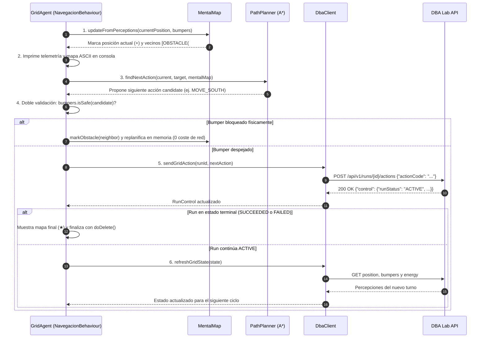

# Guía Maestra de Estudio y Defensa: Práctica 2 (Bloque Grid 2D)
**Asignatura:** Diseño Basado en Agentes (DBA) — Curso 2026/2027  
**Profesor:** Manuel Jesús Cobo Martín — Universidad de Granada (UGR)  

---

## 1. Estructura General del Proyecto y Paquetes

Todo el código fuente ejecutable del proyecto se aloja en el paquete raíz `com.mycompany.agentesp2`:

```text
agentesp2/
├── pom.xml                               # Configuración Maven (Java 17, JADE 4.6.0, org.json, JUnit)
├── config.properties                     # DBA_LAB_URL y DBA_TOKEN
├── run.sh                                # Script de automatización de compilación, tests y ejecución
└── src/
    ├── main/java/com/mycompany/agentesp2/
    │   ├── Main.java                     # Lanzador unificado con selector de agente (grid/termostato)
    │   ├── TestConexion.java             # Comprobación de conectividad sin consumir ejecuciones
    │   │
    │   ├── api/                          # [REUTILIZADO Y EXTENDIDO] Capa de Comunicación REST
    │   │   ├── DbaClient.java            # Cliente HTTP con soporte Grid e Idempotencia
    │   │   └── DbaException.java         # Excepciones tipadas con código de estado HTTP
    │   │
    │   ├── model/                        # [REUTILIZADO Y EXTENDIDO] Modelos Comunes y Dominio
    │   │   ├── RunStatus.java            # Enum universal: ACTIVE, SUCCEEDED, FAILED, EXPIRED, etc.
    │   │   ├── RunControl.java           # DTO transversal: runId, runStatus, reasonCode, actionStatus
    │   │   ├── ThermostatAction.java     # [NO USADO EN GRID] Exclusivo de control térmico
    │   │   ├── ThermostatState.java      # [NO USADO EN GRID] Exclusivo de control térmico
    │   │   └── grid/                     # [NUEVO] Modelos específicos de Navegación 2D
    │   │       ├── GridAction.java       # Enum cardinal: NORTH, EAST, SOUTH, WEST (dx, dy)
    │   │       ├── GridPosition.java     # Coordenada inmutable (x, y), Manhattan, equals/hashCode
    │   │       ├── GridBumpers.java      # Sensores de colisión [N, E, S, W] e isSafe(action)
    │   │       ├── GridEnergy.java       # Saldo de energía ("FINITE", remaining) y hasEnergy()
    │   │       └── GridState.java        # DTO agregador de percepciones de Grid y RunControl
    │   │
    │   ├── termostato/                   # [NO USADO EN GRID] Capa de Agente Térmico
    │   │   └── TermostatoAgent.java      # Agente JADE específico del Bloque 1
    │   │
    │   └── grid/                         # [NUEVO] Capa de Agente y Navegación 2D
    │       ├── GridAgent.java            # Agente JADE con NavegacionBehaviour y doble validación
    │       └── navigation/               # Cerebro Algorítmico y Memoria
    │           ├── CellType.java         # Enum: FREE, OBSTACLE, UNKNOWN
    │           ├── MentalMap.java        # Memoria espacial dinámica (HashMap) y render ASCII
    │           └── PathPlanner.java      # Algoritmo Optimistic Online A* con desempate cuádruple
    │
    └── test/java/com/mycompany/agentesp2/grid/ # [NUEVO] Tests Unitarios Offline
        ├── GridPositionTest.java         # Tests de geometría, Manhattan y parseo JSON
        └── PathPlannerTest.java          # Simulador local offline de los 7 mapas y meta inalcanzable
```

---

## 2. Matriz Integral de Ficheros: Reutilizados, No Utilizados y Creados

### 2.1. Ficheros REUTILIZADOS del Bloque 1 (y por qué)

Gracias al diseño por capas implementado en la fase anterior, gran parte de la infraestructura técnica es 100% independiente del tipo de problema:

| Fichero y Paquete | Rol | Justificación de Diseño y Reutilización |
| :--- | :--- | :--- |
| **`api/DbaClient.java`**<br>`com.mycompany.agentesp2.api` | Cliente HTTP REST | Reutiliza la gestión de conexión con `java.net.http.HttpClient`, cabecera `Authorization: Bearer`, serialización con `org.json`, control de errores, lectura de variables de entorno y el `ShutdownHook` de la JVM con `.active_run_id`. Solo se añadieron métodos de conveniencia para Grid sin alterar la base. |
| **`api/DbaException.java`**<br>`com.mycompany.agentesp2.api` | Excepción tipada | Centraliza el manejo de códigos de estado HTTP (401, 404, 409, 422, 503) y códigos de error del servidor de forma idéntica para cualquier reto de DBA Lab. |
| **`model/RunStatus.java`**<br>`com.mycompany.agentesp2.model` | Enum de estado de run | Define los estados universales de un run (`ACTIVE`, `SUCCEEDED`, `FAILED`, `EXPIRED`, `CANCELLED`). Es un concepto transversal del laboratorio, independiente de si el agente es un termostato o un robot móvil. |
| **`model/RunControl.java`**<br>`com.mycompany.agentesp2.model` | DTO de telemetría | Encapsula el bloque común `"control"` devuelto por el servidor (`runId`, `runStatus`, `reasonCode`, `actionStatus`). Se reutiliza tanto al recibir respuestas de acciones como al consultar sensores. |
| **`Main.java`**<br>`com.mycompany.agentesp2` | Punto de entrada | Se adaptó para actuar como lanzador unificado: analiza argumentos por consola para arrancar `grid` o `termostato`, selecciona retos numéricos y gestiona la conexión con el contenedor principal JADE. |
| **`TestConexion.java`**<br>`com.mycompany.agentesp2` | Test de conectividad | Permite diagnosticar en 1 segundo si el servidor universitario `orca.ugr.es` está online y listar todos los retos disponibles sin gastar ejecuciones. |
| **`run.sh`** | Script de terminal | Automatiza `mvn compile`, `mvn test` y la ejecución de ambos agentes mediante subcomandos (`./run.sh grid 1`, `./run.sh test-unit`, etc.). |
| **`config.properties`** | Configuración externa | Almacena `DBA_LAB_URL` y `DBA_TOKEN`, válidos para toda la asignatura. |
| **`pom.xml`** | Descriptor Maven | Mantiene las dependencias compartidas: JADE 4.6.0, `org.json` y el framework de pruebas JUnit. |

---

### 2.2. Ficheros NO UTILIZADOS en el Bloque Grid (y por qué)

Estos ficheros forman parte del proyecto pero corresponden exclusivamente a la lógica del Bloque 1 (Termostato):

| Fichero y Paquete | Motivo por el que NO interviene en Grid 2D |
| :--- | :--- |
| **`termostato/TermostatoAgent.java`**<br>`com.mycompany.agentesp2.termostato` | Agente JADE específico de control térmico. Su comportamiento (`ControlTemperaturaBehaviour`) regula una variable escalar unidimensional continua (temperatura) contra perturbaciones. El agente Grid requiere navegación espacial en dos dimensiones con percepción parcial. |
| **`model/ThermostatAction.java`**<br>`com.mycompany.agentesp2.model` | Enum con las acciones físicas del refrigerador: `REFRIGERATION_ON` y `REFRIGERATION_OFF`. Incompatible con el espacio de acciones de navegación en cuadrícula. |
| **`model/ThermostatState.java`**<br>`com.mycompany.agentesp2.model` | DTO específico de sensores térmicos: temperatura actual, temperatura objetivo y límites de seguridad `[lower, upper]`. |
| **Métodos de termostato en `DbaClient.java`** (`initThermostatState`, `refreshThermostatTemperature`, `sendAction`) | Métodos que consultan el sensor `thermostat.temperature` y envían acciones de refrigeración. El agente `GridAgent` no los invoca jamás. |

---

### 2.3. Ficheros CREADOS NUEVOS para Grid 2D

| Fichero y Paquete | Responsabilidad en la Navegación 2D |
| :--- | :--- |
| **`model/grid/GridAction.java`** | Enum con las 4 acciones cardinales (`MOVE_NORTH`, `MOVE_EAST`, `MOVE_SOUTH`, `MOVE_WEST`), vectores $(\Delta x, \Delta y)$ y acción inversa `opposite()`. |
| **`model/grid/GridPosition.java`** | Coordenada inmutable $(x, y)$, distancia Manhattan, vecinos y métodos estrictos `equals()` y `hashCode()` para búsquedas en grafos. |
| **`model/grid/GridBumpers.java`** | Sensores de proximidad en 4 direcciones y método de seguridad preventiva `isSafe(action)`. |
| **`model/grid/GridEnergy.java`** | Saldo de batería restante (`remaining`) y control de parada antes de agotamiento. |
| **`model/grid/GridState.java`** | DTO centralizador de la percepción del agente (posición, meta, bumpers, energía y `RunControl`). |
| **`grid/navigation/CellType.java`** | Estados epistemológicos de las casillas: `FREE`, `OBSTACLE` y `UNKNOWN`. |
| **`grid/navigation/MentalMap.java`** | Mapa mental dinámico sobre `HashMap` (sin asumir tamaño prefijado), contador de visitas y renderizador ASCII. |
| **`grid/navigation/PathPlanner.java`** | Algoritmo **Optimistic Online $A^*$** con cola de prioridad y desempate cuádruple. |
| **`grid/GridAgent.java`** | Agente JADE con `NavegacionBehaviour`, doble validación contra choques y cierre seguro en `takeDown()`. |
| **`test/grid/GridPositionTest.java`** | Tests unitarios de geometría, cálculo de adyacencia y parseo JSON. |
| **`test/grid/PathPlannerTest.java`** | Simulador offline en memoria que valida la resolución de los 7 mapas y meta inalcanzable sin internet. |

---

## 3. Ciclo de Ejecución en Cada Paso Temporal

En cada ejecución de `action()` dentro del comportamiento `NavegacionBehaviour` de `GridAgent.java`:



---

## 4. Desglose Detallado de Clases de Navegación 2D

### 4.1. `model/grid/GridPosition.java`
- **Rol**: Modela una coordenada inmutable $(x, y)$.
- **Reglas de Coordenadas de DBA Lab**:
  - $(0, 0)$ arriba a la izquierda.
  - Eje $X$ (columnas): crece hacia la derecha (Este, $\Delta x = +1$) y decrece hacia la izquierda (Oeste, $\Delta x = -1$).
  - Eje $Y$ (filas): crece hacia abajo (Sur, $\Delta y = +1$) y decrece hacia arriba (Norte, $\Delta y = -1$).
- **Por qué `equals()` y `hashCode()` son obligatorios**:
  - `GridPosition` actúa como clave en `Map<GridPosition, CellType>`, `Map<GridPosition, Integer>` y en los conjuntos `closedSet` y `bestG` del algoritmo $A^*$. Si no se sobreescriben basándose en `x` e `y`, Java compararía la referencia de memoria del objeto, impidiendo reconocer que dos instancias distintas representan la misma casilla $(4, 5)$.
- **Métodos principales**:
  - `neighbor(GridAction action)`: calcula la casilla resultante tras aplicar una acción.
  - `manhattanDistance(GridPosition other)`: calcula $|x_1 - x_2| + |y_1 - y_2|$.
  - `actionTowards(GridPosition neighbor)`: deduce la acción cardinal entre casillas contiguas.

### 4.2. `model/grid/GridAction.java`
- Enum seguro con las 4 acciones cardinales:
  - `MOVE_NORTH("grid.move.north", 0, -1)`
  - `MOVE_EAST("grid.move.east", 1, 0)`
  - `MOVE_SOUTH("grid.move.south", 0, 1)`
  - `MOVE_WEST("grid.move.west", -1, 0)`
- Método `opposite()`: devuelve la dirección opuesta (`NORTH <-> SOUTH`, `EAST <-> WEST`), fundamental para retrocesos o razonamiento simétrico.

### 4.3. `model/grid/GridBumpers.java`
- Encapsula los 4 booleanos del sensor `grid.bumpers`: `north`, `east`, `south`, `west`.
- `isBlocked(action)`: retorna `true` si hay un muro o límite en esa dirección. Moverse en esa dirección provocaría `FAILED` inmediato por colisión.
- `isSafe(action)`: retorna `!isBlocked(action)`. Funciona como la barrera de seguridad reactiva del agente antes de autorizar cualquier movimiento.

### 4.4. `model/grid/GridEnergy.java`
- Encapsula el modo (`"FINITE"`) y las unidades disponibles (`remaining`) del sensor `grid.energy`.
- Cada movimiento en el servidor consume 1 unidad.
- `hasEnergy()`: valida si `remaining > 0` para ordenar una parada controlada antes de gastar la última unidad.

### 4.5. `model/grid/GridState.java`
- DTO que agrupa `currentPosition`, `targetPosition`, `bumpers`, `energy` y `RunControl`.
- Actualiza automáticamente el estado de control tras cada lectura de sensor o acción física.
- `isAtTarget()`: determina si el agente ha llegado exactamente a la meta.

### 4.6. `grid/navigation/CellType.java` y `MentalMap.java`
- `CellType`: `FREE` (transitable comprobada), `OBSTACLE` (muro o borde) y `UNKNOWN` (niebla de guerra).
- **Diseño con `HashMap` frente a matriz `char[10][10]`**:
  > [!IMPORTANT]
  > En la Tanda 1 los mapas son de 10×10, pero en la **Tanda 2 los mundos tendrán tamaños y formas desconocidos a priori**. Usar un array fijo `char[10][10]` provocaría desbordamientos de índice (`ArrayIndexOutOfBoundsException`) ante mapas mayores o si el agente se asoma a coordenadas de borde como $x = -1$ o $x = 10$. El `HashMap` permite registrar coordenadas arbitrarias de forma elástica sin desperdiciar memoria.
- **Actualización inteligente (`updateFromPerceptions`)**:
  - Marca la casilla actual como `FREE` e incrementa su contador en `visitCounts`.
  - Proyecta los bumpers a las 4 direcciones adyacentes: si el bumper es `true` marca `OBSTACLE`; si es `false` marca `FREE` (¡descubrimiento a distancia sin pisar la casilla!).
- **Render ASCII (`renderAscii`)**:
  - Imprime la cuadrícula con numeración y simbología clara: `@` (agente), `$` (meta), `★` (éxito en meta), `#` (muros detectados), `+` (casillas ya pisadas), `.` (vistas libres) y `?` (niebla desconocida).

---

## 5. El Cerebro Algorítmico: Optimistic Online $A^*$ (`PathPlanner.java`)

### 5.1. ¿Por qué "Online" y por qué "Optimista"?
1. **Online**: El mapa es inicialmente desconocido. El agente debe planificar con la información que tiene, ejecutar un paso en el entorno real, percibir los nuevos obstáculos locales y volver a planificar.
2. **Optimista (*Assumption of Free Space*)**: Toda celda desconocida (`UNKNOWN`) se presume transitable a coste 1. Solo lo confirmado como `OBSTACLE` se considera intransitable. Si el agente fuera pesimista, creería que está rodeado de muros y se negaría a avanzar.

### 5.2. Formulación Matemática de la Evaluación de Nodos
$$f(n) = g(n) + h(n)$$
- $g(n)$: coste real acumulado desde la posición actual del agente (1 unidad por movimiento hipotético).
- $h(n)$: distancia Manhattan hasta la meta $(x_{meta}, y_{meta})$:
  $$h(n) = |x_n - x_{meta}| + |y_n - y_{meta}|$$

#### Demostración Formal de Admisibilidad y Consistencia
- **Admisibilidad ($h(n) \le h^*(n)$)**: En una cuadrícula con movimientos exclusivamente ortogonales, Manhattan representa el camino más corto en línea recta sin muros. Cualquier obstáculo solo puede mantener o incrementar la distancia real ($h^*(n) \ge h(n)$). Al no sobrestimar nunca el coste real, $A^*$ garantiza encontrar la trayectoria óptima bajo el conocimiento disponible.
- **Consistencia (Desigualdad Triangular)**: Para dos celdas vecinas $n$ y $n'$ con coste de arista $c(n, n') = 1$, la distancia Manhattan varía como máximo en $\pm 1$:
  $$h(n) \le 1 + h(n')$$
  Al ser consistente, no es necesario reabrir nodos ya explorados en el conjunto cerrado (`closedSet`).

### 5.3. Desempate Cuádruple en la Cola de Prioridad (`SearchNode.compareTo`)
Para evitar oscilaciones o bucles infinitos en zonas abiertas con idéntico coste $f(n)$:
```java
@Override
public int compareTo(SearchNode other) {
    // 1. Menor coste total f(n) = g(n) + h(n)
    int cmp = Integer.compare(this.f, other.f);
    if (cmp != 0) return cmp;

    // 2. Desempate: menor heurística h(n) (priorizar acercarse a la meta)
    cmp = Integer.compare(this.h, other.h);
    if (cmp != 0) return cmp;

    // 3. Desempate: menor visitCount en MentalMap (evita re-visitar celdas ya pisadas)
    cmp = Integer.compare(this.visits, other.visits);
    if (cmp != 0) return cmp;

    // 4. Desempate: preferir celdas confirmadas FREE frente a UNKNOWN a igualdad total
    return Boolean.compare(other.confirmedFree, this.confirmedFree);
}
```

### 5.4. Cómo Resuelve las Trampas Cóncavas (U, C y Arco)

#### Fracaso de un Algoritmo Voraz (*Greedy Best-First Search*)
Un agente voraz solo evalúa la distancia a la meta en sus 4 vecinos inmediatos. Al entrar en una barrera en **U** cuya apertura mira al Norte y la meta está al Sur:
1. Entra por la apertura y avanza hacia el fondo porque cada paso al Sur reduce la distancia Manhattan.
2. Al llegar al muro del fondo, para escapar debe retroceder al Norte, pero eso **aumenta** la distancia Manhattan.
3. El agente voraz se niega a retroceder, oscila indefinidamente contra el muro y agota la energía.

#### Éxito de Optimistic Online $A^*$
1. Cuando el agente llega a la celda $(4, 4)$ en el fondo de la U, su sensor `bumpers.south` detecta el muro y `MentalMap` marca $(4, 5)$ como `OBSTACLE`.
2. En el turno siguiente, $A^*$ replanifica la ruta completa desde $(4, 4)$ hasta la meta.
3. Al estar el Sur bloqueado por celdas `OBSTACLE`, el camino continuo más corto en el grafo es:
   - Retroceder al Norte: $(4, 4) \rightarrow (4, 3) \rightarrow (4, 2) \rightarrow (4, 1) \rightarrow (4, 0)$.
   - Bordear el obstáculo por el exterior hacia el Este: $(4, 0) \rightarrow (7, 0) \rightarrow (7, 7) \rightarrow (4, 7)$.
4. La primera acción planificada es `MOVE_NORTH`. El agente retrocede sin titubeos, sale de la U y rodea el muro limpiamente.

---

## 6. El Agente JADE y Seguridad (`grid/GridAgent.java`)

### 6.1. Ciclo de Vida del Agente
- **`setup()`**:
  1. Conecta con `DbaClient`.
  2. Resuelve el reto dinámicamente con `resolveChallenge()` (acepta selector numérico 1..7 o nombre).
  3. Inicia el run con `startRunTyped(challengeId)` y lee las 4 percepciones iniciales con `initGridState(runId)`.
  4. Instancia `MentalMap` y `PathPlanner`.
  5. Añade el comportamiento: `addBehaviour(new NavegacionBehaviour())`.
- **`NavegacionBehaviour` (`action()` y `done()`)**:
  - Cada invocación de `action()` ejecuta **un único paso** respetando la concurrencia cooperativa de JADE (sin monopolizar el hilo del agente).
  - Consulta `done()` tras cada paso: cuando el run termina (`SUCCEEDED`, `FAILED`) o se agota la energía, finaliza el comportamiento.
- **`takeDown()`**:
  - Si el run quedó en estado `ACTIVE` tras una detención forzada (`Ctrl+C`), llama inmediatamente a `client.closeRun(runId)` para **evitar dejar bloqueado el token del estudiante** en DBA Lab.
  - Si se ejecuta como contenedor secundario o sin ventana, destruye su propio contenedor con `getContainerController().kill()` y cierra su JVM limpiamente.

### 6.2. Doble Barrera de Seguridad Reactiva: `selectValidatedSafeAction()`
Antes de enviar cualquier petición HTTP al servidor, el método `selectValidatedSafeAction()` comprueba si la acción propuesta por $A^*$ cumple `state.getBumpers().isSafe(candidate)`:
- Si el bumper físico indica bloqueo, cancela la acción de inmediato, marca la celda como `OBSTACLE` en el `MentalMap` y vuelve a planificar en memoria.
- **Coste**: 0 peticiones de red y 0 unidades de energía consumidas. Cero colisiones garantizadas.

---

## 7. Capa de Red e Idempotencia (`api/DbaClient.java`)

### 7.1. Validación Estricta de Capacidades (`validateGridCapabilities`)
Antes de iniciar ningún run, el cliente analiza el JSON devuelto por `GET /api/v1/challenges`:
- Valida la presencia de los 4 sensores: `grid.position`, `grid.target`, `grid.bumpers`, `grid.energy`.
- Valida la presencia de las 4 acciones: `grid.move.north`, `grid.move.east`, `grid.move.south`, `grid.move.west`.
- Si falta alguno, lanza `DbaException(422, "MISSING_CAPABILITY")` impidiendo arrancar retos incompatibles.

### 7.2. Protocolo de Idempotencia en `sendGridAction()`
> [!WARNING]
> La petición `POST /api/v1/runs/{id}/actions` **NO es idempotente**: cada llamada ejecutada con éxito consume 1 unidad de energía y avanza el reloj de la simulación.

Si se produce un error `HTTP 503 Service Unavailable` o un corte de red durante la respuesta:
- **Peligro**: Si se reintenta el `POST` a ciegas y la primera petición sí llegó al servidor, el agente se moverá dos veces, gastando doble energía o chocando.
- **Solución implementada (`recoverControlAfterUncertainAction`)**:
  1. No reintenta el `POST`.
  2. Consulta la operación segura de lectura `GET /api/v1/runs/{id}` (`getRunStatus`).
  3. Consulta `GET /api/v1/runs/{id}/actions/last` (`getLastAction`).
  4. Sincroniza el estado del agente con el estado real registrado en el servidor sin riesgo alguno.

---

## 8. Resultados de la Batería de Pruebas Offline (`test/grid/PathPlannerTest.java`)

Los 12 tests unitarios offline se ejecutan en local sin necesidad de conexión a Internet:
```bash
./run.sh test-unit
```

| Escenario Evaluado | Inicio $\rightarrow$ Meta | Pasos Reales | Límite Batería | Colisiones | Resultado |
| :--- | :---: | :---: | :---: | :---: | :---: |
| **1. Campo abierto** | $(0, 0) \rightarrow (9, 9)$ | **18 pasos** | 50 | 0 | **SUPERADO** (Óptimo Manhattan exacto) |
| **2. Muro vertical** | $(1, 5) \rightarrow (8, 5)$ | **17 pasos** | 60 | 0 | **SUPERADO** (Rodea el muro) |
| **3. Muro horizontal** | $(5, 1) \rightarrow (5, 8)$ | **19 pasos** | 60 | 0 | **SUPERADO** (Rodea el muro) |
| **4. Muro diagonal** | $(1, 1) \rightarrow (8, 8)$ | **16 pasos** | 80 | 0 | **SUPERADO** (Supera la escalera sin trabarse) |
| **5. Barrera en U** | $(4, 1) \rightarrow (4, 8)$ | **29 pasos** | 100 | 0 | **SUPERADO** (Entra, detecta, retrocede y rodea) |
| **6. Barrera en C** | $(1, 5) \rightarrow (8, 5)$ | **27 pasos** | 100 | 0 | **SUPERADO** (Escapa de la concavidad lateral) |
| **7. Barrera en arco** | $(4, 1) \rightarrow (4, 8)$ | **25 pasos** | 100 | 0 | **SUPERADO** (Sortea el arco convexo/cóncavo) |
| **8. Meta Encerrada** | $(1, 1) \rightarrow (5, 5)$ | 67 pasos | 200 | 0 | **PARADA CONTROLADA** (Detecta que no hay ruta sin chocar) |

---

## 9. Banco Maestro de Preguntas y Respuestas para la Defensa

### Bloque A: Arquitectura y Reutilización de Código

#### P1: ¿Qué partes del código habéis reutilizado del Bloque 1 (Termostato) y por qué no habéis tenido que volver a programar la comunicación HTTP ni los estados del run?
> **Respuesta:** Gracias a la separación por capas implementada en el Bloque 1, toda la capa `api/` (`DbaClient`, `DbaException`) y los modelos `RunStatus` y `RunControl` son completamente agnósticos del tipo de problema. Toda la lógica de conexión con `HttpClient`, autenticación con token Bearer, captura de desconexiones en `ShutdownHook`, fichero `.active_run_id` y parsing JSON es transversal. Para Grid 2D solo hemos tenido que modelar las percepciones geométricas en `model/grid/`, el cerebro de búsqueda en `grid/navigation/` y el agente `GridAgent`, reutilizando el 100% de la infraestructura de red.

#### P2: ¿Por qué no habéis eliminado las clases del Termostato (`TermostatoAgent`, `ThermostatState`, etc.)?
> **Respuesta:** Para mantener la integridad de la práctica completa en un único repositorio unificado. El proyecto cuenta con un punto de entrada polivalente en `Main.java` y un script `run.sh` que permite compilar y ejecutar tanto los retos de control térmico (`./run.sh termostato`) como los de navegación (`./run.sh grid 1`), manteniendo el código desacoplado y modular.

---

### Bloque B: Algoritmia e Inteligencia Artificial

#### P3: ¿Por qué habéis utilizado el algoritmo $A^*$ en lugar de Dijkstra o Búsqueda en Anchura (BFS)?
> **Respuesta:** Dijkstra y BFS exploran el mapa de forma radial uniforme en todas direcciones, expandiendo decenas de nodos innecesarios. $A^*$ incorpora la función heurística $h(n)$ (distancia Manhattan) que orienta la búsqueda directamente hacia la meta, reduciendo radicalmente los nodos explorados y permitiendo calcular la siguiente acción en pocos milisegundos.

#### P4: ¿Por qué la distancia Manhattan es adecuada aquí? ¿Es admisible y consistente?
> **Respuesta:** En una cuadrícula donde el agente solo puede realizar movimientos ortogonales con coste 1, la distancia Manhattan $|x_1 - x_2| + |y_1 - y_2|$ es la distancia teórica mínima sin obstáculos. Dado que la presencia de muros solo puede igualar o incrementar la distancia real ($h^*(n) \ge h(n)$), jamás sobrestima el coste real, siendo **admisible**. Además, al moverse a una celda vecina la distancia varía como máximo en 1 por paso, cumpliendo la desigualdad triangular $h(n) \le 1 + h(n')$, lo que asegura que es **consistente** y evita tener que reabrir nodos de `closedSet`.

#### P5: ¿Por qué el algoritmo es "Optimista"? ¿Qué sucedería si fuera "Pesimista"?
> **Respuesta:** Se basa en el principio de *Assumption of Free Space*: el agente asume que toda celda no percibida (`UNKNOWN`) es transitable hasta que un sensor físico demuestre lo contrario. Si fuera pesimista y asumiera que lo desconocido son muros, el agente consideraría desde el primer instante que está encerrado y que no existe ruta posible, negándose a moverse.

#### P6: ¿Por qué un algoritmo voraz (*Greedy Best-First*) falla en las barreras en U o C y vuestro $A^*$ no?
> **Respuesta:** Un algoritmo voraz solo evalúa la distancia a la meta en los vecinos inmediatos; al entrar en la U, cada paso hacia el fondo reduce la distancia a la meta, pero al toparse con el fondo se queda atrapado porque para salir necesita dar pasos que aumentan temporalmente la distancia Manhattan. Nuestro agente, al detectar los muros con los bumpers, los registra como `OBSTACLE` en su `MentalMap`. En la siguiente iteración, $A^*$ planifica el camino completo considerando el coste acumulado $g(n)$; como el fondo está bloqueado, el camino de menor coste total $f = g + h$ es salir de la U y rodearla por fuera.

#### P7: ¿Cómo evitáis que el agente caiga en bucles infinitos de oscilación entre casillas libres?
> **Respuesta:** Mediante tres mecanismos complementarios:
> 1. En `MentalMap` llevamos un contador `visitCounts` de cuántas veces hemos pisado cada casilla.
> 2. En `SearchNode.compareTo`, a igualdad de coste $f(n)$ y de heurística $h(n)$, priorizamos los nodos con menor `visitCount`, penalizando el retroceso a zonas ya visitadas.
> 3. La función de coste acumulado $g(n)$ crece con cada paso virtual, haciendo que los caminos con ciclos tengan un coste $f(n)$ estrictamente mayor y sean descartados por la cola de prioridad.

---

### Bloque C: Agentes y Plataforma JADE

#### P8: ¿Por qué se utiliza un `Behaviour` en lugar de un bucle `while(true)` dentro de `setup()`?
> **Respuesta:** JADE asigna un único hilo de ejecución a cada agente. Si introdujéramos un bucle infinito en `setup()`, monopolizaríamos ese hilo, impidiendo que el agente procese el ciclo de vida de la plataforma, atienda mensajes o ejecute otros comportamientos. Los `Behaviour` permiten la concurrencia cooperativa gestionada por el planificador interno de JADE.

#### P9: ¿Qué papel juegan `action()` y `done()` en `NavegacionBehaviour`?
> **Respuesta:** `action()` ejecuta una única iteración del ciclo (percibir, actualizar mapa, planificar y enviar un paso). JADE consulta `done()` tras cada llamada a `action()`: mientras devuelva `false`, el planificador seguirá programando el behaviour; en cuanto el agente alcanza la meta o el run pasa a estado terminal, `done()` devuelve `true` y el comportamiento se retira limpiamente de la cola.

#### P10: ¿Cómo se comunica el agente con la plataforma gráfica RMA sin lanzar múltiples ventanas?
> **Respuesta:** Hemos diseñado `Main.java` con soporte de contenedores distribuidos:
> - `./run.sh server` arranca el `Main-Container` persistente en el puerto 1099 con la GUI (RMA).
> - Al lanzar `./run.sh grid 1`, el script detecta mediante un socket TCP si el puerto 1099 está ocupado y arranca el agente como un contenedor secundario ligero (`-container -host localhost -port 1099`). Al terminar el reto, el agente destruye su contenedor secundario con `kill()`, dejando la plataforma RMA intacta.

---

### Bloque D: Protocolo y API REST de DBA Lab

#### P11: ¿Por qué no consultamos el sensor `grid.target` en cada turno igual que hacemos con `grid.position` y `grid.bumpers`?
> **Respuesta:** Porque la meta es estacionaria durante todo el reto. Consultarla en cada paso supondría una petición HTTP redundante que ralentizaría la ejecución del agente sin aportar información nueva. Por el contrario, la posición, los bumpers y la energía cambian con cada movimiento y deben refrescarse obligatoriamente.

#### P12: ¿Consultar percepciones evita que caduque el run por inactividad a los 5 minutos?
> **Respuesta:** No. En la especificación oficial de DBA Lab, las consultas de lectura (`GET /perceptions`) no reinician el temporizador de inactividad de 5 minutos ni avanzan el reloj de la simulación. La simulación solo avanza y el temporizador solo se renueva cuando se aplica una acción física válida (`POST /actions`).

#### P13: ¿Qué hacéis si la llamada a `POST /actions` devuelve un error 503 o se corta la red?
> **Respuesta:** Aplicamos una estricta política de idempotencia. Nunca reintentamos el `POST` a ciegas, porque si la acción original ya había sido aplicada por el servidor, un segundo `POST` movería al agente dos veces, consumiendo doble energía o provocando un choque. En su lugar, invocamos `GET /runs/{id}` y `GET /runs/{id}/actions/last` para auditar el estado real del servidor y resincronizar el agente.

#### P14: ¿Por qué en `takeDown()` cerramos el run si sigue activo?
> **Respuesta:** Para evitar el bloqueo de concurrencia de DBA Lab. La API del laboratorio solo permite un run activo simultáneo por estudiante. Si un alumno detiene su agente con `Ctrl+C` sin cerrar el run, su token quedaría bloqueado durante 5 minutos hasta que el servidor lo expire por inactividad. Al capturar `takeDown()`, nos aseguramos de liberar el token de inmediato.

---

### Bloque E: Decisiones de Diseño e Ingeniería de Software

#### P15: ¿Por qué habéis modelado las coordenadas con una clase inmutable `GridPosition`?
> **Respuesta:** Porque en algoritmos de búsqueda basados en grafos y árboles como $A^*$, las posiciones se comparten entre múltiples nodos de búsqueda y estructuras como `openSet` y `closedSet`. Si `GridPosition` fuera mutable, modificar una coordenada en un nodo alteraría involuntariamente el estado de los nodos padres o corrompería las claves dentro del `HashMap` de `MentalMap`.

#### P16: ¿Por qué no habéis asumido un mapa de 10×10 en el código?
> **Respuesta:** Para cumplir con el principio de generalización para la Tanda 2. En la Tanda 2 los mundos tendrán dimensiones arbitrarias no reveladas de antemano. `MentalMap` utiliza una representación dispersa en memoria (`HashMap<GridPosition, CellType>`) que crece dinámicamente y puede registrar cualquier coordenada, incluso valores negativos o superiores a 10 si el agente fuera situado cerca de un borde.

#### P17: ¿Cómo garantizáis al 100% que el agente nunca se estrelle contra un muro?
> **Respuesta:** Mediante una arquitectura de **doble barrera de seguridad**:
> 1. *Barrera de Planificación*: `PathPlanner` solo considera transitables celdas que no estén marcadas como `OBSTACLE`.
> 2. *Barrera Reactiva Física*: Antes de emitir cualquier petición HTTP al servidor, el método `selectValidatedSafeAction()` consulta `bumpers.isSafe(candidate)`. Si el sensor físico indica que hay un obstáculo en esa dirección (por ejemplo, una celda que el planificador asumió libre por optimismo), la acción es cancelada de inmediato, la celda se marca como `OBSTACLE` y se replanifica en memoria sin enviar nada al servidor.

---

## 10. Chuleta de Comandos Rápidos para la Defensa

### 1. Demostración Offline Inmediata (¡Ideal para empezar!)
```bash
cd Termostato/Codigo/agentesp2
./run.sh test-unit
```
> *Ejecuta los 12 tests en ~1 segundo, demostrando que el agente supera los 7 mapas sin chocar y se detiene ante metas inalcanzables.*

### 2. Comprobar Conexión con DBA Lab (Sin consumir runs)
```bash
./run.sh test
```
> *Lista los retos activos en DBA Lab con sus capacidades.*

### 3. Ejecutar los Retos de Navegación Grid 2D en DBA Lab
```bash
# Reto 1: Campo abierto
./run.sh grid 1

# Reto 2: Muro vertical
./run.sh grid 2

# Reto 5: Barrera en U (¡El más recomendable para enseñar al profesor!)
./run.sh grid 5

# Selección por nombre
./run.sh grid "Barrera en U"
```

### 4. Modo Servidor Gráfico JADE (Opcional)
```bash
# Terminal 1: Servidor central persistente con RMA
./run.sh server

# Terminal 2: Lanzamiento del agente sobre el contenedor principal
./run.sh grid 5
```
