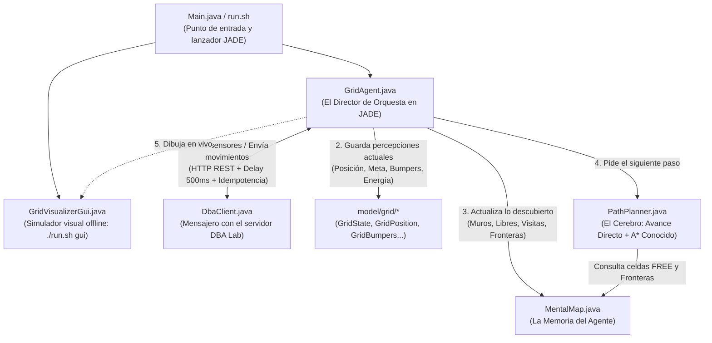
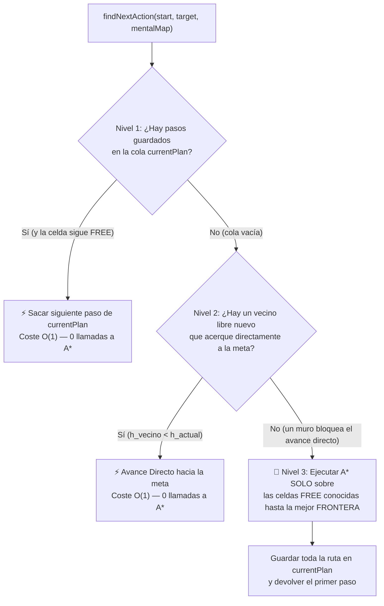
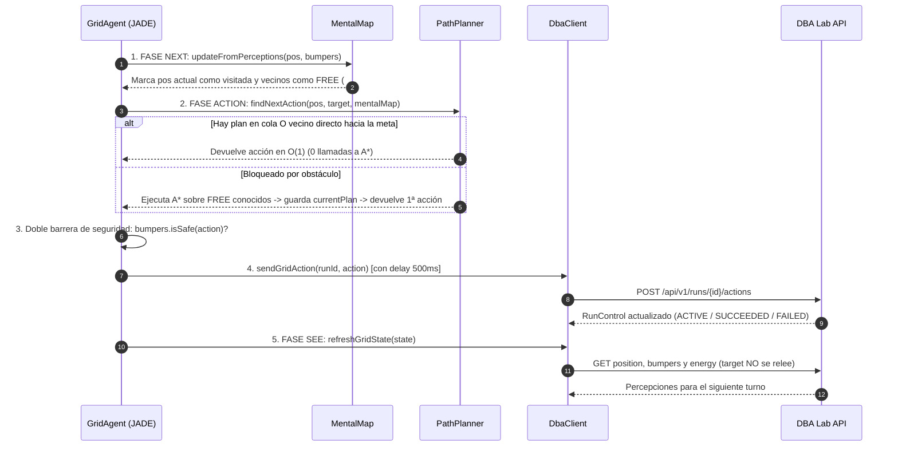

# Guía Maestra de Estudio y Defensa: Práctica 2 (Bloque Grid 2D)
**Asignatura:** Diseño Basado en Agentes (DBA) — Curso 2026/2027  
**Profesor:** Manuel Jesús Cobo Martín — Universidad de Granada (UGR)  

> [!TIP]
> **Objetivo de esta guía:** Que cualquier miembro del equipo entienda de forma sencilla qué hace cada clase del proyecto, cómo se conectan entre ellas y cómo responder con seguridad a las preguntas del profesor en la defensa.

---

## 1. Visión Rápida: ¿Qué hace nuestro proyecto y cómo se relacionan las clases?

En el bloque **Grid 2D**, nuestro agente (Wall-e) debe ir desde una casilla de salida hasta una meta (EVA) en un mapa desconocido. Sabemos **dónde está la meta** (nos lo dice el sensor `grid.target` al empezar), pero **no sabemos dónde están los muros**; solo los vamos descubriendo paso a paso con 4 sensores de contacto (*bumpers*: Norte, Este, Sur y Oeste).

Para resolverlo de forma limpia y modular, dividimos el proyecto en **5 piezas que colaboran entre sí**:



### Resumen en una frase de cada clase del Grid

| Clase | Analogía sencilla | ¿Qué hace exactamente? |
| :--- | :--- | :--- |
| **`Main.java`** | El interruptor de arranque | Lee qué quieres ejecutar (`server`, `grid`, `termostato`, `gui`), comprueba si el servidor JADE ya está encendido en el puerto 1099 y lanza el agente con un nombre único (`grid_<timestamp>`). |
| **`DbaClient.java`** | El teléfono / mensajero | Habla por HTTP con el servidor `orca.ugr.es`. Aplica un retardo de **500 ms** entre peticiones (protección térmica del servidor) y controla que nunca se repita un movimiento físico si falla la red (idempotencia). |
| **`GridState.java`** *(y resto de `model/grid/`)* | La ficha de datos del turno | Agrupa en objetos Java limpios lo que el agente percibe en este instante: dónde está (`GridPosition`), dónde está la meta, qué detectan los 4 `GridBumpers`, cuánta `GridEnergy` queda y el `RunControl` del servidor. |
| **`MentalMap.java`** | El cuaderno de apuntes (Memoria) | Guarda en un `HashMap` únicamente las casillas que el agente ha descubierto (`FREE` o `OBSTACLE`), cuántas veces ha pisado cada una (`visitCounts`) e identifica qué casillas son **Fronteras** (`isFrontier`). |
| **`PathPlanner.java`** | El cerebro / GPS inteligente | Decide cuál es el siguiente movimiento (`NORTH`, `EAST`, `SOUTH`, `WEST`). **Solo llama a $A^*$ cuando un muro bloquea el camino directo**, y cuando lo hace, busca únicamente sobre el mapa conocido y guarda el plan en cola (`currentPlan`). |
| **`GridAgent.java`** | El director de orquesta (Agente JADE) | Ejecuta el ciclo de vida de JADE (`setup`, `NavegacionBehaviour`, `takeDown`). En cada turno coordina: leer sensores (`see`) $\to$ actualizar `MentalMap` (`next`) $\to$ pedir paso a `PathPlanner` y moverse (`action`). |
| **`GridVisualizerGui.java`** | La pantalla de radar | Interfaz gráfica en Swing. Sirve tanto para probar 10 mapas en local sin internet (`./run.sh gui`) como para ver en vivo al agente real cuando se conecta a DBA Lab (`./run.sh grid <N>`). |

---

## 2. Estructura Completa de Carpetas

```text
agentesp2/
├── pom.xml                               # Configuración Maven (Java 17, JADE 4.6.0, org.json, JUnit)
├── config.properties                     # DBA_LAB_URL, DBA_TOKEN y DBA_REQUEST_DELAY_MS=500
├── run.sh                                # Script rápido: gui, server, grid, termostato, test-unit
├── batch_runner.py                       # Ejecutor automático de los 19 retos en DBA Lab
└── src/
    ├── main/java/com/mycompany/agentesp2/
    │   ├── Main.java                     # Lanzador unificado (gui / server / grid / termostato)
    │   ├── TestConexion.java             # Diagnóstico de conexión con DBA Lab sin gastar runs
    │   ├── api/                          # [COMPARTIDO CON BLOQUE 1]
    │   │   ├── DbaClient.java            # Cliente HTTP REST, delay térmico 500ms e idempotencia
    │   │   └── DbaException.java         # Excepciones tipadas con código HTTP
    │   ├── model/                        # [COMPARTIDO Y EXTENDIDO]
    │   │   ├── RunStatus.java            # ACTIVE, SUCCEEDED, FAILED, EXPIRED, CANCELLED
    │   │   ├── RunControl.java           # runId, runStatus, reasonCode, actionStatus
    │   │   └── grid/                     # Modelos específicos de Grid 2D
    │   │       ├── GridAction.java       # MOVE_NORTH, MOVE_EAST, MOVE_SOUTH, MOVE_WEST
    │   │       ├── GridPosition.java     # Coordenada (x, y) inmutable + manhattanDistance()
    │   │       ├── GridBumpers.java      # Sensores [N, E, S, W] e isSafe(action)
    │   │       ├── GridEnergy.java       # Energía restante y hasEnergy()
    │   │       └── GridState.java        # Estado consolidado del turno actual
    │   ├── termostato/                   # [BLOQUE 1 - NO USADO EN GRID]
    │   │   └── TermostatoAgent.java
    │   └── grid/                         # [BLOQUE 2 - NAVEGACIÓN 2D]
    │       ├── GridAgent.java            # Agente JADE + ciclo see/next/action
    │       ├── gui/
    │       │   └── GridVisualizerGui.java # Interfaz gráfica Swing (Simulador + Monitor en vivo)
    │       └── navigation/
    │           ├── CellType.java         # FREE, OBSTACLE, UNKNOWN
    │           ├── MentalMap.java        # Mapa disperso, contador de visitas y detección de fronteras
    │           └── PathPlanner.java      # Avance directo O(1) + Cola currentPlan + A* sobre lo conocido
    └── test/java/com/mycompany/agentesp2/
        ├── api/DbaClientDelayTest.java   # Verifica el retardo térmico de 500 ms
        └── grid/
            ├── GridPositionTest.java     # Tests de coordenadas y distancia Manhattan
            └── PathPlannerTest.java      # Simulador offline (7 mapas 10x10 + encerrada + masivo 100x100)
```

---

## 3. Cómo funciona nuestro Cerebro Algorítmico (`PathPlanner.java`)

> [!IMPORTANT]
> **Punto clave de la defensa (la mejora pedida por el profesor):**  
> En una versión inicial, el agente ejecutaba $A^*$ en **cada paso** intentando calcular una ruta hasta la meta atravesando todo el mapa desconocido (`UNKNOWN`). Eso funcionaba en mapas pequeños de $10 \times 10$, pero en **mapas masivos** ($100 \times 100$, $500 \times 500$...) sería lentísimo porque $A^*$ expandiría miles de casillas imaginarias en cada turno y tiraría la ruta tras dar un solo paso.

Para resolverlo de forma **sencilla, óptima y escalable a mapas masivos**, `PathPlanner.findNextAction()` funciona ahora en **3 niveles en cascada**:



### Nivel 1: Reutilizar el plan guardado (`currentPlan`) — ¡Sin replanificar!
* Cuando $A^*$ calcula una ruta de varios pasos por el mapa conocido (por ejemplo, 8 pasos para salir de una barrera en U hasta una frontera despejada), guarda todos esos pasos en una cola: `Queue<GridAction> currentPlan`.
* En los turnos siguientes, como toda esa ruta pasa por casillas ya confirmadas como `FREE`, el agente **no vuelve a ejecutar $A^*$**: simplemente extrae el siguiente paso con `currentPlan.poll()` en tiempo **$O(1)$**.

### Nivel 2: Avance Directo sin llamar a $A^*$ (`findDirectForwardFrontier`)
* Si no hay plan en cola, antes de crear colas de prioridad ni ejecutar $A^*$, el agente mira únicamente sus **4 casillas vecinas inmediatas** (Norte, Este, Sur, Oeste).
* Comprueba si alguna cumple 3 condiciones:
  1. Está confirmada como libre (`isKnownFree`).
  2. Es la meta o es una casilla frontera nueva (`isFrontier`, nunca pisada y junto a terreno desconocido).
  3. **Reduce la distancia Manhattan a la meta** ($h_{\text{vecino}} = h_{\text{actual}} - 1$).
* **¿Por qué esto es matemáticamente equivalente a $A^*$?**  
  Porque la distancia Manhattan es la cota mínima posible: si damos 1 paso ($g=1$) que reduce la distancia en 1 ($h = h_{\text{actual}} - 1$), el coste total es $f = g + h = 1 + (h_{\text{actual}} - 1) = h_{\text{actual}}$. Ningún otro camino del mapa puede mejorar ese valor. Por tanto, **avanzar directamente en $O(1)$ elige exactamente la misma casilla que elegiría $A^*$**, pero haciendo **0 llamadas a $A^*$** en campo abierto y en todos los tramos rectos despejados.

### Nivel 3: $A^*$ actuando exclusivamente sobre lo conocido (Exploración por Fronteras)
* **¿Cuándo se llama a $A^*$?** Únicamente cuando la cola `currentPlan` está vacía **y** un obstáculo nos impide acercarnos directamente a la meta (es decir, ninguno de los 4 vecinos libres reduce $h$).
* **¿Sobre qué busca $A^*$?** **Exclusivamente sobre celdas `CellType.FREE` ya descubiertas en el `MentalMap`**. Jamás expande celdas `UNKNOWN` (`?`).
* **¿Cuándo para $A^*$?** En cuanto saca de la cola de prioridad:
  * La meta $G$ (si ya ha sido vista como libre), **o**
  * La mejor **celda Frontera** (`MentalMap.isFrontier`): una celda que los bumpers ya confirmaron como `FREE`, que el agente aún no ha pisado (`visitCount == 0`) y que tiene al menos un vecino `UNKNOWN` (`?`) por descubrir (Tema 2, Diapositivas 88-89).
* **Escalabilidad a mapas masivos:** Como $A^*$ nunca entra en la zona desconocida (`?`), da igual si el mapa mide $10 \times 10$ o $10.000 \times 10.000$: el grafo de búsqueda solo contiene las casillas que el robot ha descubierto hasta ese momento.

### Criterios de prioridad de $A^*$ en `SearchNode.compareTo`
Para elegir la mejor frontera sin oscilar entre los extremos de un muro:
1. **Menor $f(n) = g(n) + h(n)$:** Minimiza los pasos por el mapa conocido hasta la frontera ($g$) más la distancia Manhattan desde esa frontera hasta la meta ($h$).
2. **Menor $g(n)$ (frontera más cercana al agente):** A igualdad de $f(n)$ (típico entre los dos lados de un muro), prefiere la frontera que está más cerca de donde estamos ahora, evitando dar media vuelta y retroceder inútilmente.
3. **Menor número de visitas (`visits`):** Prioriza fronteras vírgenes (`visits = 0`).
4. **Mayor información esperada (`unknownNeighbors`):** Prefiere la frontera que descubre más casillas `?` nuevas (Diapositiva 89).
5. **Orden canónico determinista (`seq`):** Respeta el orden `Norte -> Este -> Sur -> Oeste` (Diapositiva 49).

---

## 4. Ciclo de Ejecución Paso a Paso en `GridAgent.java`

En cada iteración de `NavegacionBehaviour.action()` se sigue el ciclo formal de agentes con estado interno del Tema 2 (**`next` $\to$ `action` $\to$ `see`**):



---

## 5. Detalles Clave de las Demás Clases

### `MentalMap.java` (Memoria Espacial)
* **¿Por qué usa `HashMap` y no `char[10][10]`?** Porque en la Fase 2 los mapas tienen tamaños desconocidos y mucho mayores. Un `HashMap<GridPosition, CellType>` crece dinámicamente y admite cualquier coordenada sin límite fijo ni desbordamientos.
* **Métodos clave:**
  * `updateFromPerceptions(pos, bumpers)`: marca `pos` como `FREE`, suma 1 a su `visitCounts` y clasifica los 4 vecinos cardinales como `FREE` u `OBSTACLE`.
  * `isKnownFree(pos)`: devuelve `true` solo si la celda ya es conocida y es `FREE` (base de nuestro $A^*$ sobre lo conocido).
  * `isFrontier(pos)`: devuelve `true` si es `FREE`, tiene `visitCount == 0` y al menos uno de sus 4 vecinos es `UNKNOWN`.
  * `countUnknownNeighbors(pos)`: cuenta cuántos vecinos `?` descubriríamos al pisar `pos`.

### `GridPosition.java` (Coordenadas y Distancia Manhattan)
* Es **inmutable** (`final int x, y`) e implementa `equals()` y `hashCode()` para poder usarse como clave en `HashMap` y `HashSet`.
* **Distancia Manhattan:** `Math.abs(this.x - other.x) + Math.abs(this.y - other.y)`. Es **admisible** (nunca sobrestima los pasos reales en una cuadrícula de 4 direcciones) y **consistente** (al moverse 1 casilla varía como máximo en $\pm 1$).

### `DbaClient.java` (Red, Protección Térmica e Idempotencia)
* **Retardo térmico obligatorio (`DBA_REQUEST_DELAY_MS = 500`):** Espera al menos 500 ms entre peticiones HTTP para proteger la CPU del servidor universitario `orca.ugr.es`.
* **Idempotencia en `sendGridAction()`:** `POST /actions` mueve al robot y gasta 1 de energía. Si ocurre un fallo de red o HTTP 503, **nunca reintenta el `POST` a ciegas** (duplicaría el movimiento). En su lugar, audita el estado con peticiones pasivas seguras: `GET /runs/{id}` y `GET /runs/{id}/actions/last`.
* **Cierre limpio en `takeDown()`:** Si se aborta el agente con `Ctrl+C`, `takeDown()` llama a `client.closeRun(runId)` para no dejar el token del estudiante bloqueado durante 5 minutos.

### `GridVisualizerGui.java` (Interfaz Gráfica Visual)
* Permite demostrar en vivo cómo el agente descubre la niebla de guerra, marca fronteras (puntos celestes), cuenta visitas, guarda su cola `currentPlan` (línea magenta discontinua) y muestra en el panel derecho exactamente **cuándo usa Avance Directo $O(1)$**, **cuándo usa la Cola $O(1)$** y **cuándo despierta a $A^*$**.

---

## 6. Resultados de Pruebas Offline (`./run.sh test-unit`)

Los **16 tests unitarios** (4 de `GridPositionTest`, 9 de `PathPlannerTest` y 3 de `DbaClientDelayTest`) pasan al 100% en ~2 segundos sin internet:

| Escenario Evaluado | Pasos (Batería) | Llamadas a $A^*$ | Nodos Expandidos | Resultado |
| :--- | :---: | :---: | :---: | :---: |
| **1. Campo abierto (10x10)** | **18 pasos** (óptimo) | **0 llamadas** | **0 nodos** | ✅ Superado |
| **2. Muro vertical (10x10)** | **17 pasos** (óptimo) | 5 llamadas | 15 nodos | ✅ Superado |
| **3. Muro horizontal (10x10)** | **15 pasos** | 4 llamadas | 10 nodos | ✅ Superado |
| **4. Muro diagonal (10x10)** | **16 pasos** (óptimo) | **1 llamada** | **1 nodo** | ✅ Superado |
| **5. Barrera en U (10x10)** | **35 pasos** | 10 llamadas | 77 nodos | ✅ Superado |
| **6. Barrera en C (10x10)** | **21 pasos** | 7 llamadas | 42 nodos | ✅ Superado |
| **7. Barrera en arco (10x10)** | **29 pasos** | 12 llamadas | 75 nodos | ✅ Superado |
| **8. Meta encerrada** | 79 pasos (parada segura) | — | Solo celdas `FREE` | ✅ Parada controlada |
| **9. Mapa Masivo (100x100)** | **185 pasos** | **46 llamadas** | **1.081 nodos (~2 ms)** | ✅ Superado |

---

## 7. Banco de Preguntas y Respuestas para la Defensa

### Preguntas sobre el Algoritmo y la Mejora para Mapas Masivos

#### P1: ¿Por qué no llamáis a $A^*$ en cada paso? ¿Cuándo se ejecuta exactamente?
> **Respuesta:** Llamar a $A^*$ en cada turno es innecesario y costoso en mapas grandes. Nuestro `PathPlanner` solo invoca a $A^*$ cuando se dan **dos condiciones a la vez**: (1) no tenemos pasos pendientes en la cola `currentPlan` y (2) ningún vecino libre adyacente nos acerca directamente a la meta. Mientras el camino hacia la meta está despejado, el agente avanza en $O(1)$ sin llamar a $A^*$; por ejemplo, en *Campo abierto* hace **0 llamadas a $A^*$**, y en *Muro diagonal* solo hace **1 llamada**.

#### P2: ¿Por qué el avance directo sin $A^*$ no empeora la solución?
> **Respuesta:** Por la consistencia de la heurística Manhattan. Si estamos a distancia $h$ de la meta y una casilla vecina libre y no visitada está a distancia $h - 1$, su coste estimado en $A^*$ es $f = g + h = 1 + (h - 1) = h$, que es la cota inferior matemática imposible de mejorar. Por tanto, es un atajo exacto en $O(1)$ que produce la misma decisión que $A^*$.

#### P3: ¿Cómo funciona vuestro $A^*$ "en base a lo conocido" y por qué sirve para mapas masivos?
> **Respuesta:** En vez de expandir miles de casillas desconocidas (`UNKNOWN`) intentando llegar a una meta que puede estar a cientos de casillas en un mapa masivo, nuestro $A^*$ **solo expande celdas confirmadas como `FREE` en el `MentalMap`**. Su objetivo dentro del mapa conocido es llegar a la mejor **celda frontera** (una celda `FREE` vista por los bumpers, aún no pisada y colindante con `?`) minimizando $f(n) = g(n) + h(n)$. Así, el coste de cálculo solo depende de lo que el agente ha explorado y no del tamaño total del mundo.

#### P4: ¿Cómo evitáis volver a ejecutar $A^*$ mientras el agente sale de un callejón o barrera en U?
> **Respuesta:** Cuando $A^*$ encuentra el camino por el mapa conocido desde el fondo de la trampa hasta la mejor frontera exterior (por ejemplo, 8 pasos), guarda toda la secuencia en la cola `currentPlan`. Como todas las casillas intermedias ya estaban visitadas y confirmadas como `FREE`, en los turnos siguientes el agente simplemente consume `currentPlan.poll()` en $O(1)$ sin volver a llamar a $A^*$ hasta llegar a la frontera.

#### P5: ¿Cómo sabéis dónde está la meta si el mapa es desconocido?
> **Respuesta:** El servidor DBA Lab ofrece el sensor `grid.target`, que consultamos una única vez al arrancar en `DbaClient.initGridState()`. Conocemos sus coordenadas $(x, y)$ para poder calcular la distancia Manhattan $h(n)$, pero no conocemos los obstáculos que hay entre medias; esos los descubrimos con `grid.bumpers`.

#### P6: ¿Por qué desempatáis en $A^*$ por menor $g(n)$ (frontera más cercana al agente) en vez de menor $h(n)$?
> **Respuesta:** Porque en exploración online, al rodear un muro largo, la frontera que tienes justo delante ($g=1$) y la frontera que dejaste atrás en el otro extremo del muro ($g=5$) suelen empatar en el mismo $f = g + h$. Si desempatáramos por menor $h$, el agente daría media vuelta constantemente haciendo un efecto péndulo entre ambos extremos. Al desempatar por menor $g$, el agente sigue rodeando el muro en la dirección actual sin retrocesos innecesarios.

#### P7: ¿Cómo detecta el agente que una meta está encerrada (inalcanzable)?
> **Respuesta:** Cuando el agente ha visitado todas las casillas alcanzables de su zona, ya no queda ninguna casilla `FREE` con `visitCount == 0` junto a terreno `UNKNOWN` (no quedan fronteras). La cola `openSet` de $A^*$ se vacía sin encontrar ni la meta ni ninguna frontera, `findPath` devuelve lista vacía y `GridAgent` realiza una parada controlada limpia sin chocar ni gastar el resto de batería.

---

### Preguntas sobre JADE, Arquitectura y API REST

#### P8: ¿Por qué usáis un `Behaviour` en `GridAgent` en lugar de un bucle `while` en `setup()`?
> **Respuesta:** En JADE cada agente tiene un único hilo cooperativo. Un bucle `while` en `setup()` bloquearía el hilo e impediría que JADE gestione el ciclo de vida del agente o sus mensajes. Con `NavegacionBehaviour`, cada `action()` ejecuta un único paso y `done()` indica cuándo terminar limpiamente.

#### P9: ¿Cómo garantizáis que el agente nunca choca contra un muro?
> **Respuesta:** Doble barrera de seguridad: primero, `PathPlanner` solo propone movimientos hacia celdas confirmadas como `FREE` en `MentalMap`; segundo, antes de enviar el HTTP, `selectValidatedSafeAction()` verifica físicamente `state.getBumpers().isSafe(candidate)`. Si fallase, marca el obstáculo, limpia `currentPlan` y replanifica en memoria con 0 coste de energía.

#### P10: ¿Qué hace `DbaClient` si falla la red o recibe un HTTP 503 al enviar un movimiento?
> **Respuesta:** Nunca reintenta el `POST /actions` a ciegas porque no es idempotente (podría mover al robot dos veces). En su lugar consulta los endpoints pasivos `GET /runs/{id}` y `GET /runs/{id}/actions/last` para comprobar si el servidor llegó a aplicar la acción y resincronizar el estado.

#### P11: ¿Por qué cerramos el run en `takeDown()` y por qué hay un retardo de 500 ms?
> **Respuesta:** DBA Lab solo permite un run activo simultáneo por token; cerrar el run en `takeDown()` evita que el alumno quede bloqueado 5 minutos si pulsa `Ctrl+C`. El retardo de 500 ms (`DBA_REQUEST_DELAY_MS`) protege la CPU del servidor `orca.ugr.es` frente a ráfagas de peticiones.

---

## 8. Chuleta de Comandos para la Defensa

```bash
cd ~/NetBeansProjects/agentesp2

# 1. Abrir la interfaz gráfica interactiva (sin internet, 10 mapas disponibles)
./run.sh gui        # O directamente un mapa: ./run.sh gui 5

# 2. Ejecutar los 16 tests unitarios offline (incluye mapa masivo 100x100)
./run.sh test-unit

# 3. Comprobar conexión con DBA Lab sin gastar runs
./run.sh test

# 4. Ejecutar contra DBA Lab (Terminal 1: servidor JADE | Terminal 2: reto Grid)
./run.sh server
./run.sh grid 5
```
